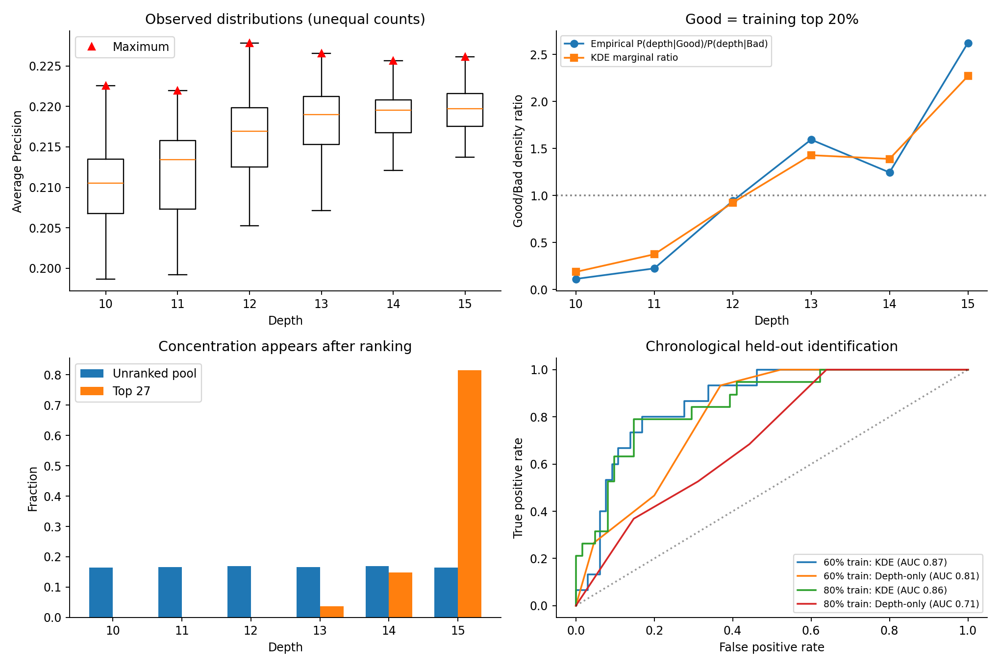
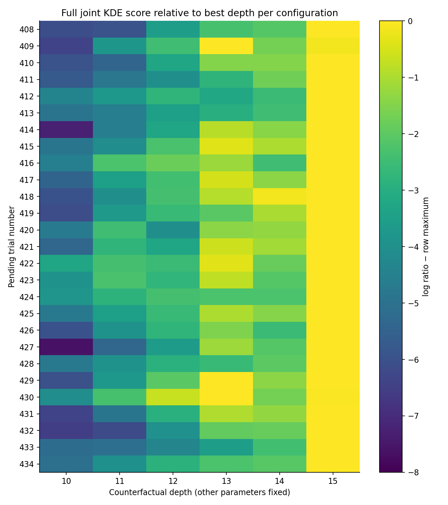

# CatBoost depth preference: KDE diagnostic

Study **cat_20261006-2021_random_opt-ap-v1_data:20260924T005634Z-2ad3**, ID **38**, Average Precision **maximize**. Diagnostic date: **2026-10-23**.

**Finding:** Depth 15 has a real empirical advantage for reliably reaching the upper AP tail, and the production KDE predicts held-out good trials well. The exact 22/27 concentration is a consequence of ranking a balanced finite candidate pool with a joint density ratio. It is **not evidence that 81.5% of future trials should optimally use depth 15**, nor that depth 15 gives the best achievable AP. No scoring or sampling implementation error was found in the checks below; the strength of concentration is less stable than the direction of preference.

## 1. Data and empirical distributions

399 completed finite-objective trials; 9 failures excluded. The source also contains 1 running and 26 waiting trials, none used as training observations. The 27 fixed configurations from those pending trials match **exactly pool ranks 1–27**. This establishes the original proposals rather than substituting a newly chosen set. Trial ordering is ascending Optuna trial number. Complete trial extraction used one SQLite `mode=ro` read transaction.

| Depth | n | Median AP | 90th percentile | Maximum AP | Top 10% rate | Top 20% rate | Empirical L/G | KDE L/G |
|---|---|---|---|---|---|---|---|---|
| 10 | 72 | 0.210541 | 0.217357 | 0.222532 | 1.4% | 2.8% | 0.114 | 0.189 |
| 11 | 56 | 0.213450 | 0.219074 | 0.221964 | 0.0% | 5.4% | 0.226 | 0.376 |
| 12 | 68 | 0.216911 | 0.222319 | 0.227852 | 10.3% | 19.1% | 0.943 | 0.924 |
| 13 | 77 | 0.219005 | 0.222723 | 0.226533 | 14.3% | 28.6% | 1.595 | 1.429 |
| 14 | 63 | 0.219556 | 0.222880 | 0.225651 | 14.3% | 23.8% | 1.246 | 1.390 |
| 15 | 63 | 0.219736 | 0.223896 | 0.226158 | 19.0% | 39.7% | 2.623 | 2.270 |

Membership rates divide by the observed count **at that depth**, not by an assumed equal allocation. The empirical density ratio is `(Good_at_depth / 80) / (Bad_at_depth / 319)`, equivalently the depth-specific Good/Bad odds divided by global Good/Bad odds. KDE Good is the best **ceil(0.2 × 399) = 80** observations, with stable trial-order tie breaking; its lowest Good AP is **0.2208121031**. The descriptive top-10% and top-20% rates use all-data quantiles (**0.2222698408** and **0.2208072548** respectively); they select the same 40/80 observations here.

Depth 12 has the highest observed maximum (**0.227852**), while depth 15 has the highest median, 90th percentile and elite membership. Those measure different properties. The top-20% membership at depth 15 is **25/63 = 39.7%**, versus **13/68 = 19.1%** at depth 12. Wilson 95% intervals are **28.5–52.0%** versus **11.5–30.0%**. Depth 15 versus depths 13 and 14 is less decisive: their Good rates are 28.6% and 23.8%, with overlapping intervals. Exploratory, unadjusted Fisher tests give p=0.012 (15 vs 12), 0.208 (15 vs 13), and 0.084 (15 vs 14); these are post-hoc comparisons, not a confirmation that 15 dominates all alternatives. Median/quantile bootstrap intervals and all rate intervals are in [empirical_depth_summary.csv](empirical_depth_summary.csv). Maxima are noisy order statistics and are not assigned naive bootstrap confidence intervals.

## 2. Actual production KDE and exact score reproduction

Used the existing **saved production fit**, with six-dimensional statsmodels `KDEMultivariate`, types **cooccc** in parameter order `bagging_temperature, depth, iterations, l2_leaf_reg, learning_rate, random_strength`. Depth is an ordinal grid index 0–5 with a **Wang–Ryzin kernel**, not a continuous Gaussian. Iterations is ordinal too (step 100). The remaining dimensions are Gaussian after declared-bound linear/log transformations. The model uses separate bounded leave-one-out maximum-likelihood bandwidth fits for Good and Bad, L-BFGS-B, maxiter=200, ftol=1e-10, gtol=1e-5, maxls=40, 120-second fit bound; no fallback or post-fit clipping. Depth bandwidths are **0.35010 / 0.35596** (Good / Bad), both interior and similar. All six bandwidths and fit diagnostics are recorded in [provenance.json](provenance.json).

Production and local `kde.py` / `coverage_candidates.py` hashes match. Training trial IDs, Good memberships and encoded model data match the read-only study extraction. All **10,000 saved scores reproduce with maximum absolute error 0**. For the 27 proposals, log-density evaluation also agrees with direct statsmodels `pdf` to **8.9×10⁻¹⁶** in log space. A numerical finite-difference check of the saved-fit LOO gradient gives maximum absolute errors **2.3×10⁻¹⁰**. These checks support correct execution of the intended model; they do not establish that the model is optimal.

| Pending trial | Depth | log l | log g | log l − log g |
|---|---|---|---|---|
| 408 | 15 | -3.4859 | -9.8975 | 6.4116 |
| 409 | 15 | -3.8142 | -9.7066 | 5.8924 |
| 410 | 15 | -4.0057 | -9.8003 | 5.7946 |
| 411 | 15 | -3.5729 | -9.1597 | 5.5868 |
| 412 | 15 | -3.2458 | -8.8081 | 5.5624 |

All 27 configurations, separate `log_l` and `log_g`, raw score and original pool rank are in [proposal_scores.csv](proposal_scores.csv). All **162** depth substitutions, with every other parameter fixed, are in [proposal_depth_counterfactuals.csv](proposal_depth_counterfactuals.csv). Displayed relative scores subtract the same best-observed-trial reference (**3.745706**) and therefore do not change rankings.

| Depth | Unranked pool n (%) | Top 100 n | Top 27 n | Best depth in 27 counterfactual contexts |
|---|---|---|---|---|
| 10 | 1649 (16.5%) | 0 | 0 | 0 |
| 11 | 1661 (16.6%) | 0 | 0 | 0 |
| 12 | 1687 (16.9%) | 3 | 0 | 0 |
| 13 | 1655 (16.6%) | 21 | 1 | 3 |
| 14 | 1699 (17.0%) | 22 | 4 | 0 |
| 15 | 1649 (16.5%) | 54 | 22 | 24 |

Pool generation was reproduced **configuration-for-configuration** with the actual saved settings: 10,000 unseen legal samples, seed 42, in 10,240 draws. Each depth has 16.49–16.99% representation. The production generator respects the original declared distribution and objective-independent generation; no depth-15-heavy input pool explains 22/27. Top 100 has only **54%** depth 15, illustrating how taking the extreme top 27 intensifies concentration. The 27 selected configurations are a correlated ranking output, **not 27 independent votes or a binomial experiment**.

### Marginal signal plus context dependence

The marginal empirical ratio already favors depth 15 (**2.623**) and the smoothed KDE marginal agrees (**2.270**). Smoothing attenuates, rather than invents, this advantage. On the full 10,000 candidate contexts, holding other features fixed and evaluating all six depths, depth 15 wins **6,194/10,000 = 61.94%**, depth 13 wins 16.56%, depth 14 13.82%, and depth 12 6.93% (10/11 win 0.06%/0.69%). Among the actual 27 proposal contexts, 15 wins **24**, and 13 wins **3**. Some originally selected depths 13/14 would score higher if changed to 15; the finite independent pool is not an exhaustive coordinate optimizer.

The model is a **mixture of product kernels over shared training centers**. Its joint density is an average of products; its score **cannot be decomposed into independent marginal parameter contributions**. To investigate dependence, the projection over other parameters was calculated by analytically marginalizing the existing KDE, without refitting. `joint log ratio − other-parameter marginal log ratio` is a **conditional depth density ratio**, not an independent feature attribution. At the selected configurations this conditional log ratio ranges **1.172–3.587** (median **2.335**); the unconditional depth-15 log ratio is **0.820**. Selection targets favorable combinations, so these selected-context conditional values should not be interpreted as the average effect of depth. A deliberately independent product-of-marginals diagnostic selects 24 depth-15 configurations among the top 27, compared with 22 for the actual joint model: the marginal tendency is already strong, while dependence changes which configurations rank highest.

The ordinal kernels put some mass outside the finite 10–15 domain (Good mass within it 0.91356, Bad 0.90789). Renormalizing each depth marginal over valid levels leaves 15 as the winner and only rescales all ratios by the same factor (about 0.994); simple finite-depth boundary truncation does not explain the preference. This is a marginal boundary check, not a complete finite-domain correction of the joint KDE. The ConfigSpace warning about integer steps was checked: the regenerated pool matches exactly and generated iterations honor the original Optuna step.

## 3. Preference stability across training subsets

| Training subset | Marginal best depth | Depth-15 winners among 27 contexts | Depth 15 among pool top 27 |
|---|---|---|---|
| All 399 | 15 | 24/27 | 22/27 |
| chronological_0.6 | 15 | 25/27 | 22/27 |
| chronological_0.8 | 15 | 23/27 | 18/27 |
| 20 random 80% fits | 15 in 20/20 | 19–27 / 27 | 15–25 / 27 |

The random-subset results are descriptive sensitivity analyses: 20 seeded, overlapping 80% subsamples, each with a fresh production-setting Good/Bad fit. They are not 20 independent validation experiments. The marginal preference for 15 persists in every fit; concentration among the top 27 ranges **15–25** (median **20**), and counterfactual wins range **19–27** (median **23.5**). Consequently the direction is robust, but **22/27 is not a precisely estimated allocation**. [subset_stability.csv](subset_stability.csv) contains every fit's result.

## 4. Chronological out-of-sample validation

First **239** valid trials train → next **80** evaluate (held-out trial numbers **244–324**); first **319** train → final **80** evaluate (numbers **325–406**). Nine failed trials account for gaps. Each fold uses a newly fitted production KDE and a Good threshold derived **only from that fold's training targets**: **0.2208040225**, then **0.2207665525**. Held-out Good means AP ≥ the training threshold; no held-out percentile is used. Declared parameter bounds are fixed independently of held-out outcomes. All metrics below evaluate **held-out observed trials**, not the still-unobserved proposals.

| Train / held-out | Model | ROC-AUC [95% CI] | AP metric | Precision, top 16 / 80 | Mean objective AP, top 16 |
|---|---|---|---|---|---|
| 60%→next20% | KDE | 0.866 [0.770, 0.941] | 0.546 | 56.2% | 0.220380 |
| 60%→next20% | Depth-only | 0.807 [0.704, 0.896] | 0.415 | 38.0% | 0.218914 |
| 60%→next20% | KDE excluding depth (projected) | 0.811 [0.683, 0.920] | 0.466 | 50.0% | 0.220251 |
| 60%→next20% | Constant | 0.500 [0.500, 0.500] | 0.188 | 18.8% | 0.215003 |
| 80%→next20% | KDE | 0.855 [0.742, 0.941] | 0.673 | 62.5% | 0.221637 |
| 80%→next20% | Depth-only | 0.706 [0.585, 0.819] | 0.370 | 43.8% | 0.219477 |
| 80%→next20% | KDE excluding depth (projected) | 0.743 [0.607, 0.859] | 0.472 | 50.0% | 0.221269 |
| 80%→next20% | Constant | 0.500 [0.500, 0.500] | 0.237 | 23.8% | 0.216554 |

Here **AP metric** means *average precision for classifying held-out Good*, while **objective AP** means the original CatBoost Average Precision. Constant-model AP equals held-out Good prevalence: **18.75%** and **23.75%**. The depth-only model uses Laplace-smoothed training Good membership frequencies per depth. For tied top scores (especially depth-only and constant), precision and mean AP use the expected result of random tie breaking at the selection boundary, rather than an arbitrary favorable trial ordering. The projected KDE baseline analytically drops depth from the fitted densities; it is not a separately re-optimized five-dimensional fit.

For the full KDE, top-20% selection identifies **9/16** and **10/16** held-out Good trials. Its selected configurations improve mean objective AP over the entire corresponding test set by **+0.005378 [0.003241, 0.006958]** and **+0.005083 [0.003532, 0.006686]**. Score/AP Spearman correlations are **0.814 [0.685, 0.893]** and **0.800 [0.689, 0.874]**. These are useful retrospective associations.

The full model exceeds depth-only by ROC-AUC **+0.059 [−0.067, 0.185]** and **+0.149 [−0.002, 0.300]** in paired bootstrap comparisons. The AP-classification gain is **+0.131 [−0.137, 0.386]** and **+0.302 [0.053, 0.512]**. Thus evidence of added value is stronger in the later fold, and not uniformly decisive across metrics. Comparing Good vs Bad pairs **within the same depth** gives AUC **0.744** and **0.820**, showing that the model's predictive association is not solely depth sorting.

| Split | Depth | Held-out n | Good n | Within-depth ROC-AUC | Mean AP |
|---|---|---|---|---|---|
| 60% | 10 | 18 | 0 | — | 0.209941 |
| 60% | 11 | 13 | 0 | — | 0.212305 |
| 60% | 12 | 11 | 1 | 0.900 | 0.213666 |
| 60% | 13 | 18 | 7 | 0.701 | 0.218809 |
| 60% | 14 | 13 | 3 | 0.800 | 0.217450 |
| 60% | 15 | 7 | 4 | 0.750 | 0.220797 |
| 80% | 10 | 13 | 0 | — | 0.210784 |
| 80% | 11 | 9 | 0 | — | 0.209274 |
| 80% | 12 | 18 | 6 | 0.889 | 0.217744 |
| 80% | 13 | 13 | 3 | 0.733 | 0.219257 |
| 80% | 14 | 11 | 3 | 0.458 | 0.219940 |
| 80% | 15 | 16 | 7 | 0.921 | 0.219477 |

Within-depth samples are small (7–18 per test fold), so their individual AUCs are unstable; AUC is undefined when there are no held-out Good trials. Depth 14, for example, has later-fold AUC **0.458** despite aggregate model success. The later-fold mean AP at depth 15 (**0.219477**) is slightly below depth 14 (**0.219940**), while its Good rate is higher (7/16 vs 3/11). This is another reason not to interpret the result as universal dominance of depth 15. Complete predictions and by-depth metrics are linked below.

Intervals use 1,000 test-row bootstrap resamples with the training fit held fixed (2,500 paired resamples for KDE-minus-depth comparisons). They describe test-sample uncertainty **conditional on these fitted models**, not full training/model-selection uncertainty. No independence across cross-validation folds of the underlying CatBoost training data, no hidden dataset shift, or independence of repeated HPO trials is established here. The first fold's test data legitimately enters the second fold's chronological training set; there is no second-fold future-target leakage, but the fold results are not independent replications.

## 5. Interpretation and limits

1. **Why 15?** It offers a higher probability of crossing the top-20% AP threshold, even though depth 12 produced the single best AP. The KDE targets Good/Bad density ratio, not the conditional maximum AP or expected improvement.
2. **Marginal or conditional?** A substantial preference is already marginal, with additional dependence on the other five parameters. This is a joint mixture model, not a naive independent-parameter score.
3. **Subset stability?** Depth 15 remains the marginal winner in both chronological fits and all 20 random-subset fits. The exact amount of extreme-tail concentration varies materially.
4. **Held-out predictive value?** Yes, in these two chronological tests (AUC about 0.86, precision 56–63% vs prevalence 19–24%). Depth alone explains part, but not all, of the association. Incremental uncertainty remains substantial.
5. **Implementation problem / excessive concentration?** No mismatch, reversed objective, unsupported distribution, score-floor artifact, invalid step or depth-skewed candidate generation was found. The ratio score and extreme top-K selection naturally concentrate on 15, with no diversity constraint in full-space checkbox export. Evidence does **not** determine that concentrating 22 new evaluations at depth 15 is the best optimization policy. The candidate region is more extreme than the held-out random-search distribution, the other depths have uncertainty, and near-best alternatives/context-specific exceptions remain.

This analysis is retrospective and partly motivated by patterns seen in the full dataset. It is **not a preregistered policy comparison** and cannot show that KDE-selected new trials will causally outperform a randomized or diversified allocation. No proposed configuration has a measured AP from this diagnostic. There was **no CatBoost training, no enqueueing, no Optuna writes, no implementation change, and no live-cache rewrite**. Existing study/model/candidate artifacts were only read and copied into this separate output folder; all new density fits and outputs are diagnostic artifacts.

## Supporting outputs

- [All 27 proposals and separate log densities](proposal_scores.csv)
- [All 162 depth counterfactuals](proposal_depth_counterfactuals.csv)
- [Completed trials](completed_trials.csv) and [held-out predictions](heldout_predictions.csv)
- [All empirical statistics and intervals](empirical_depth_summary.csv)
- [Held-out metrics and intervals](heldout_metrics.csv), [metrics by depth](heldout_by_depth.csv), [paired comparisons](paired_kde_vs_depth.csv)
- [10,000 candidate scores](pool_scores.csv), [concentration by top-K](pool_concentration.csv), [subset stability](subset_stability.csv)
- [Provenance, hashes, encoding and optimizer diagnostics](provenance.json), [additional audits](supplement.json)
- [Overview chart PDF](diagnostic_overview.pdf)
- Reproducible scripts: [analyze.py](analyze.py), [supplement.py](supplement.py), [report.py](report.py). Run from the DeepCAVE repository with `UV_CACHE_DIR=/tmp/deepcave-uv-cache OPENBLAS_NUM_THREADS=1 uv run --locked python diagnostics/study38_kde_20261023/analyze.py`, then `supplement.py` and `report.py`. The main script asserts that live completed-trial IDs still match the archived training snapshot; it fails rather than silently substituting a changed study.
