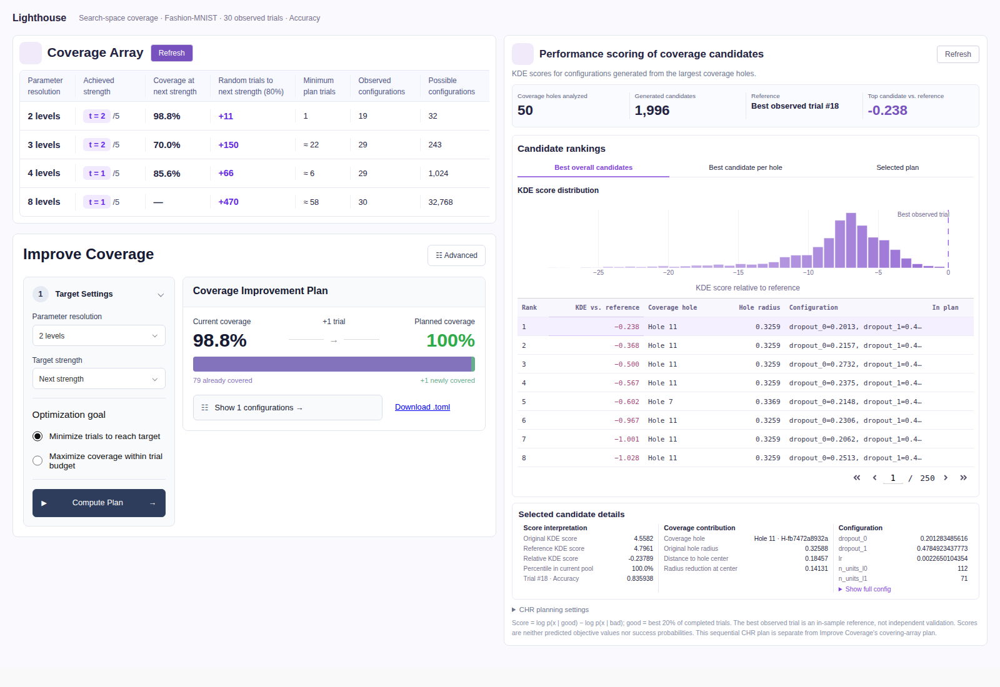

# Coverage-hole-guided KDE scoring

Implemented and checked on 2026-10-23. The production API and geometric eligibility
rule are documented in [Search Space Coverage](../../plugins/search_space_coverage.rst).

The backend is `deepcave/evaluators/coverage_candidates.py`; statistical primitives
are in `deepcave/evaluators/kde.py`. The right dashboard column uses
`deepcave/plugins/hyperparameter/performance_coverage_views.py`. The covering-array
planner on the left remains independent. CHR geometry never uses objective weights,
KDE values, or covering-array tuples.

## Statistical equivalence

The benchmark now imports the production encoding, good/bad split, LOO objective,
log-density evaluator and timeout context. Its thin `fit_kde` wrapper calls the
production fitter, preserving the benchmark's injectable timeout hook.

An AST comparison against the original benchmark from repository HEAD found
identical calculation bodies for `split_good_bad`, `kde_encoding`, `time_limit`,
`loo_objective`, `fit_kde` and `kde_logpdf`. The comparison ignores type annotations
and normalizes the fitter's injected timeout hook. Kernel formulas, optimization
bounds, initialization, analytic gradient and optimizer settings are unchanged.

Automated tests compare both optimization directions, identical bandwidth arrays,
log densities and reference scores through the benchmark and production APIs.
The 27 existing benchmark tests pass, including exact statsmodels/LOO comparisons,
analytic gradients, underflow, explicit timeout reporting and held-out leakage tests.
Production rejects unsuccessful fits and never uses the benchmark's optional
normal-reference baseline as a fallback.

## Automated verification

The targeted command was:

```sh
UV_CACHE_DIR=/tmp/deepcave-uv uv run --locked python -m pytest \
  tests/test_tpe_kde_benchmark.py tests/test_tpe_kde_coverage.py \
  tests/test_evaluators/test_coverage.py \
  tests/test_evaluators/test_coverage_candidates.py \
  tests/test_evaluators/test_performance_coverage.py \
  tests/test_plugins/test_performance_coverage_views.py \
  tests/test_plugins/test_search_space_coverage.py \
  tests/test_runs/test_converter/test_optuna.py -q --no-cov
```

Result: **318 passed, 1 failed**, in 8.40 seconds. All 29 tests of the new candidate
backend and updated right-column callbacks pass. Tests cover historical eligibility,
both directions, transformations, caching/invalidation, reference subtraction,
objective-free generation, Optuna grids, numerical forbidden constraints,
sequential radius updates, geometric admissibility despite an unfavorable score
ordering, unsupported spaces, tabs, detail selection, missing candidates, loading
and error states.

The unrelated failure is the existing
`test_refresh_computes_coverage_and_forecast_in_one_cached_job` assertion at
`tests/test_plugins/test_search_space_coverage.py:763`. It expects the old text
`Needed random trials for next strength`, whereas the unchanged left table renders
`Random trials to next strength (80%)`. That assertion and the left table were left
unchanged. The full repository suite was not run.

Flake8 passes for the new/updated scorer, views and test files. Targeted mypy reports
no issues in the three production modules. It was invoked with Python 3.10; the
installed mypy still warns about the repository's existing Python 3.9 configuration.
`git diff --check` passes.

## Actual dashboard and real-study browser check

```sh
UV_CACHE_DIR=/tmp/deepcave-uv uv run --locked python -m tests.coverage_candidates_smoke
```

This Playwright check passed for the real source
`logs/Optuna/nn_fashionmnist_mo/run_1`, selecting **Accuracy** individually from its
objectives. No search-space projection or multi-objective acquisition is used.
The harness uses production components, calculations and callbacks, replacing
only Redis/RQ transport with a local queue and precomputing fits in the main process.
It checks the reference line at zero, ranking tabs, selection of a second plan row,
full configuration expansion and explicit Refresh. It also captures a narrow viewport.

Calculated values:

| Field | Value |
| --- | ---: |
| Historical completed trials | 30 |
| Distinct CHR centers analyzed across virtual steps | 50 |
| Generated configurations, including new virtual-step centers | 1,996 |
| Sequential CHR plan configurations | 8 |
| Best observed trial number | 18 |
| Actual reference Accuracy | 0.8359375 |
| Raw reference KDE score | 4.796140913660302 |
| Highest relative candidate score | -0.23789335082319418 |

These are density-ratio scores, not predicted Accuracy. The intentionally in-sample
best-trial anchor is not model validation. Thirty historical trials suffice for this
five-dimensional demonstration's minimum group sizes; this is no claim of statistical
calibration or optimization success.



Additional screenshots, numerical model/result caches and `demo-metadata.json` are
in `cache/coverage-candidates-demo/`. They can be regenerated with the command above.

## Supported scope

Fixed, unconditional uniform/log numerical float and integer spaces are supported,
including step grids, constants and existing numerical forbidden clauses. Categorical,
ordinal, conditional, changing-distribution, Normal/Beta and explicitly weighted
integer-distribution spaces are rejected with an explanation. Both historical KDE
groups must have more observations than nonconstant dimensions. Holes remain sampled
geometric witnesses, not a certified global decomposition or covering-array tuples.
