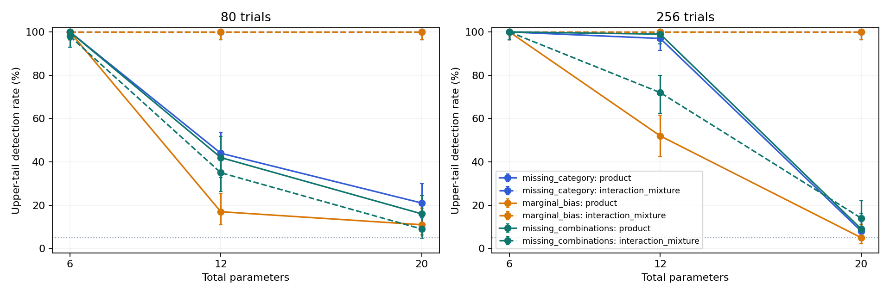

# Mixed-space MMD: kernel review and sensitivity validation

MMD remains a useful candidate, but the current product kernel is **not yet
validated as a reliable general coverage measure**. It detects the strong defects
in the six-parameter examples, while losing substantial power in larger spaces.
The experimental interaction mixture repairs some marginal sensitivity but does
not reliably detect missing combinations in the larger spaces either.

This validation changes no production kernel, dashboard defaults, or Growth code.

## Kernel design

The production kernel has one factor per varying parameter:

- Active continuous, integer, and ordinal values use Gaussian similarities on
  their existing sampling coordinates, with width 0.2.
- Active categories match by identity. Reordering categories introduces no
  geometric ordering.
- Two inactive values have similarity one; an active/inactive pair has similarity
  zero. This preserves branch activation as part of the configuration.
- Constants contribute no factor. Reference configurations obey the declared
  distributions, weights, conditions, and forbidden combinations.

The overall kernel is the product of these factors. Its inactive-state extension
is a direct sum of an active-state kernel and a one-state inactive kernel.
Products and nonnegative sums preserve positive semidefiniteness. The numerical
tests check symmetry, diagonal normalization, finite values, and eigenvalues for
mixed conditional data at widths 0.05, 0.2, and 0.5. They also verify equality of
the benchmark's product with the actual production kernel and invariance under
equivalent linear/logarithmic sampling coordinates.

**The product does not assume independent parameters.** It represents joint
features and can distinguish distributions with identical marginals. Exact
finite-population tests remove half of the two-way combinations while preserving
all marginals, and half of the three-way combinations while preserving even all
pairwise marginals. The product detects both; a purely marginal control has zero
population MMD. These checks establish joint sensitivity in controlled examples,
not finite-sample power in arbitrary dimension.

The MMD estimator and its interpretation as a distance between distribution
embeddings follow [Gretton et al., A Kernel Two-Sample Test, JMLR 2012](https://www.jmlr.org/papers/volume13/gretton12a/gretton12a.pdf).
Section 7.4 discusses dependence through joint distribution embeddings. The
mixed inactive-state construction and the conclusions below are specific to this
repository and its experiments.

## Experimental protocol

The run uses seed **20261017**, kernel version **1**, width **0.2**, **512 shared
reference configurations**, **199 independent calibration designs**, and **100
held-out evaluation designs per scenario and sample size**. Sample sizes are 80
and 256. The dashboard's default 500 calibration designs is not the setting used
in this experiment; this is a reproducible sensitivity study rather than a claim
of final release validation.

Reference and calibration seeds are disjoint from evaluation seeds. All methods
see the same designs and reference configurations. Trials fit within the
production 1,024-trial limit, so this study does not validate large-history
subsampling. Calibration is repeated separately for each kernel and trial count.
All methods use the biased empirical MMD and the dashboard's midrank tie rule.

Three fixed kernels are compared:

1. **Product:** the production kernel.
2. **Marginal:** the average of its one-dimensional factors, used as a control
   against joint-only problems.
3. **Interaction mixture:** an equal-weight mixture of the average marginal
   kernel, average pair-product kernel, and full product. This is an exploratory
   comparator, not a proposed final replacement. Its weights are fixed rather
   than selected from the evaluation labels.

For mixed spaces, two parameters are a binary category and binary integer; the
remaining parameters are independent uniform continuous nuisance dimensions.
The three strong defects are:

- **Missing category:** one of the equally likely categories is never sampled.
- **Marginal bias:** one continuous parameter is restricted to the lower half of
  its allowed interval.
- **Missing combinations:** the integer is set from the category, eliminating
  half their joint combinations without changing their population marginals.

Further spaces cover 20 binary categories, a six-parameter conditional space
including an ordinal parameter, and a category with only 2% target probability.
Conditional defects either bias an active child's values or omit a whole branch.
The categorical stress case also includes a three-way parity constraint, which
preserves all one- and two-dimensional population marginals.

The reported detection rate is the fraction above the **95th MMD percentile** of
the calibrated IID baseline. This measures the upper-tail sensitivity to the
introduced defects. It differs from the dashboard's **two-sided 5–95%** status;
both rates are retained in [results.json](results.json). Ninety-five-percent
Wilson intervals describe Monte Carlo uncertainty conditional on the fixed
reference and calibration; the figure shows the same intervals. They do not cover uncertainty across new reference
seeds, kernel widths, or defect families. Cases and sample sizes share random
seeds intentionally; their estimates are not independent of one another.

## Results

For **80 trials**, the current product kernel gives:

| Defect | 6 parameters | 12 parameters | 20 parameters |
|---|---:|---:|---:|
| Missing equally likely category | 100% | 44% | 21% |
| Continuous marginal restricted to half its range | 100% | 17% | 11% |
| Missing half the category/integer combinations | 100% | 42% | 16% |

Each percentage is measured over 100 independent evaluation draws. A measured
100% has a 95% Wilson interval of approximately **96–100%**, not a universal
guarantee. Full intervals, null evaluation rates, and the 256-trial measurements
are in [measurements.md](measurements.md).



The actual sampled product-kernel mean between distinct reference configurations
drops from approximately **0.0080** at six mixed parameters to **2.6e-8** at
twenty. Most configurations become nearly orthogonal under the kernel. This is
consistent with the loss of sensitivity; increasing sample size from 80 to 256
does not resolve the twenty-dimensional cases in this run. Detection rates are
conditional on the finite calibration and need not improve monotonically in
every measured case.

For 20 categorical parameters and 80 trials, the product flags **0/100** designs
with an entirely missing binary category in the upper tail. All distinct
reference configurations have kernel similarity zero in that sampled reference.
Many MMD values tie, making the upper-tail rule conservative. The two-sided rule
flags only **3/100** of these defective designs. Thus changing the direction of
the dashboard rank is not a remedy for this blind spot.

The interaction mixture detects missing categories and the strong marginal bias
in **100/100** of the 20-dimensional mixed designs at 80 trials, but detects the
missing combinations in only **9/100**. Simply adding marginal and pairwise
terms to one average is insufficient. Higher-order categorical defects also
remain weakly detected.

For the conditional six-parameter space at 80 trials, the production product
detects a biased active child in **93/100** and a missing branch in **100/100**.
This supports the inactive-state representation for these examples, without
establishing robustness for deep or highly unbalanced conditional hierarchies.

Held-out IID upper-tail flag rates for the product range from **0% to 9%** across
the groups; the 0% case is discrete and heavily tied. These rates must be read
alongside their intervals and the finite calibration rather than treated as
exact nominal 5% significance. The dashboard range is descriptive; looking at
many prefixes is not a single hypothesis test with a controlled overall error.

## Rare categories are a separate limitation

With a true category probability of 2%, an IID design contains no such category
with probability **0.98^80 = 19.9%**. Missing it at 80 trials cannot always be
called anomalous. At 256 trials the probability falls to about **0.57%**, so an
absence-specific diagnostic can be informative.

The product MMD nevertheless flags the missing rare category in only **2/100**
designs at 80 trials and **6/100** at 256. The interaction mixture is also weak.
MMD averages distributional discrepancies and is not a guarantee of visiting
every valid support value. Explicit support/expected-count diagnostics remain
necessary if missing rare categories are part of the coverage objective.

## Decision and next validation step

The representation of types and inactive states is mathematically defensible
and passes the targeted kernel checks. The **current full product with fixed
width 0.2 does not pass a general sensitivity requirement** over the dimensions
and defects of interest.

Before adopting a final global score:

1. Compare bandwidths and combinations of marginal, projected interaction, and
   joint MMD components on separate development scenarios.
2. Consider separately calibrated component statistics with a jointly calibrated
   aggregate, rather than diluting a single problematic pair in an average over
   all pairs. An uncalibrated maximum over many component tests would inflate
   false alarms.
3. Retain explicit category/support and hole diagnostics; distribution agreement
   and exhaustive coverage answer different questions.
4. Confirm the selected construction on new reference seeds and held-out defect
   families, including mild biases, weighted/rare branches, bandwidth variation,
   deep conditions, and histories exceeding the subsampling limit. Use the
   dashboard's 500-design calibration for that final check.

No alternative kernel is promoted by this report.

## Reproduction

From the repository root:

```bash
.venv/bin/python -m examples.api.validate_coverage_mmd \
  --trials 80 256 --dimensions 6 12 20 \
  --calibration 199 --replicates 100 --seed 20261017 \
  --output-dir docs/validation/coverage_mmd

.venv/bin/python -m pytest \
  tests/test_evaluators/test_coverage_mmd_validation.py --no-cov -q
```

The benchmark regenerates `results.json`, `measurements.md`, and `sensitivity.png`;
this review remains a separate interpretation of that fixed run. The benchmark
is deliberately outside the normal fast test suite. The twelve targeted tests
cover kernel validity, a production-kernel parity check, sampling transforms,
joint-only defects, synthetic configuration legality, tie calibration, and strong
low-dimensional sensitivity.
