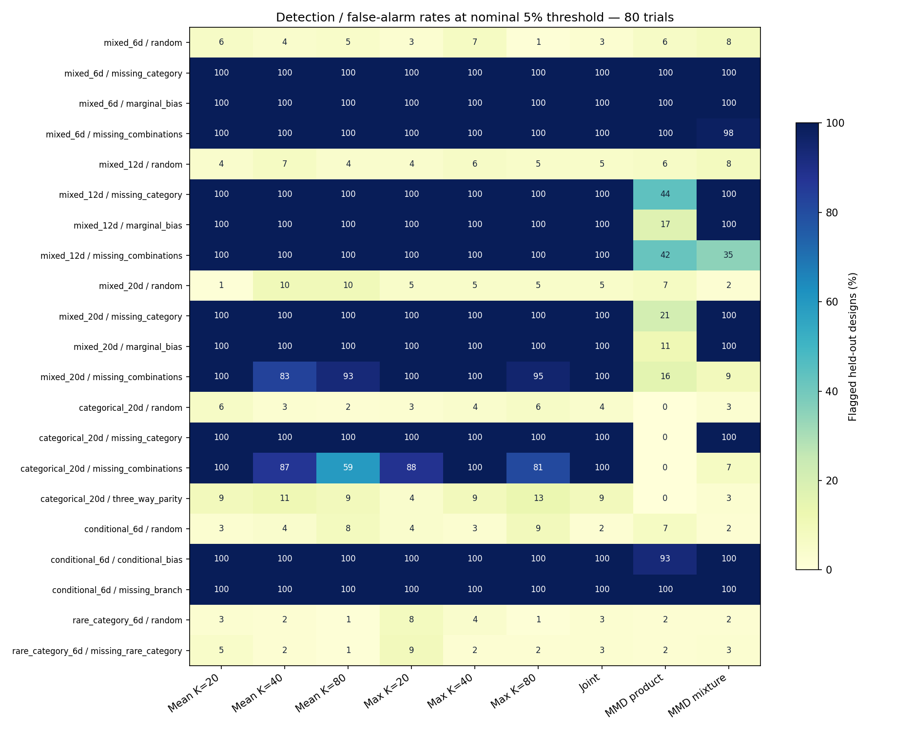

# Randomized space partitioning: an experimental coverage candidate

**This initial benchmark supports further work on randomized partitions.** At
80 trials, the jointly calibrated statistic detects all tested strong marginal
and two-way defects in 100/100 evaluation designs, including the 20-dimensional
spaces where the current MMD product kernel has low sensitivity. It still misses
most pure three-way defects. This does not establish a universally reliable
coverage measure.

This experiment changes no dashboard metric, production kernel, or Growth view.
It reuses the synthetic spaces and defect generator from the
[MMD validation](../coverage_mmd/README.md).

## Partition construction

For each space, 200 independent random recursive axis partitions are constructed
at each of K=20, 40, and 80 cells. All partitions use the same independent
8,192-configuration training pool. At each node, an eligible parameter is chosen
in random order, and a split is chosen to approximately balance probability mass
in proportion to the requested leaf counts.

- Ordered parameters use sampling coordinates and threshold splits. This
  includes integer and ordinal parameters and the existing logarithmic sampling
  transformation for numerical parameters.
- Categories use randomly ordered subset splits, not distances between category
  codes. A category identity is never split into fractional values.
- Inactive parameters have their own state. Numerical splits route inactivity
  separately from active values; category subsets can include the inactive state.
- Reference configurations obey the ConfigSpace distributions, category weights,
  conditions, and forbidden combinations. Trees classify these legal configurations;
  they do not construct configurations by combining potentially incompatible values.
- Duplicate reference configurations are compressed with their counts. A node's
  cell budget is reallocated when one side has too few distinct configurations.
  A finite discrete space cannot have more nonempty cells than distinct support
  configurations represented in the construction pool. Unseen valid configurations
  are still assigned by the tree, but features absent from the construction pool
  cannot guide its splits.

Cell probabilities are estimated using a **separate 32,768-configuration pool**.
They are not assumed to be exactly 1/K. The categorical space illustrates why:
recursive binary-category splits give dyadic probabilities, while 1/80 is not
dyadic. Mass coefficients of variation range from about 0.06 to 0.40 across this
run's space/resolution combinations; all requested cell counts are achieved.
In the conditional space, the independent mass pool leaves 1 of the 8,000 cells
at K=40 and 13 of the 16,000 cells at K=80 unvisited.
Their estimated mass is zero, not proof that their true probability is zero;
the unvisited-mass statistic therefore underweights these tiny regions. No
smoothing or minimum-mass correction is applied in this experiment. Full balance diagnostics are in
[results.json](results.json).

These axis partitions still impose a choice of spatial structure. Removing an
explicit kernel similarity does not remove the need to validate which
dependencies the representation can detect.

## What is measured

For each partition with estimated cell probabilities p_j and observed counts c_j:

- **Unvisited mass:** sum of p_j over cells with c_j=0.
- **Empty fraction:** number of empty cells divided by the cell count.
- **Histogram total variation:** half the sum of |c_j/N - p_j|.

For exactly equiprobable K=N cells, TV equals the empty fraction. This identity
is not assumed for unequal probabilities or other K. With 80 trials and 80
equiprobable cells, the expected occupied count is
`80 * (1 - (79/80)^80) = 50.755`, or **63.44%**. Ordinary random sampling leaves
about **29.245** cells empty. This is the reference expectation, not a failure
threshold.

The mean unvisited mass averages over overlapping partitions. It is **not the
probability mass of a single union of all uncovered regions**. A decrease means
that fewer probability-weighted cells remain unvisited under these fixed
partitions, not that every possible high-dimensional hole has been eliminated.

The analytic expectation for a fixed partition is
`sum(p_j * (1-p_j)^N)` for unvisited mass and
`mean((1-p_j)^N)` for empty fraction. Here those formulas use estimated cell
probabilities; IID calibration also includes actual finite-reference imbalance.

## Independent fitting, calibration, and evaluation

Seed **20261017**, N=80; mixed spaces have 6, 12, and 20 parameters. Additional
spaces contain 20 binary categorical parameters, six mixed/conditional
parameters, or a category with target probability 2%.

1. An independent set of **128 IID designs** fits the centre and scale of each
   per-partition statistic. Neither calibration designs nor evaluation designs
   influence partition splits, cell masses, or standardization.
2. **199 IID designs** calibrate each aggregate and the joint statistic.
3. **100 held-out IID designs** estimate false alarms. A further 100 designs per
   defect estimate detection. The MMD study's scenario, calibration, and evaluation
   seeds are reused exactly; the construction and fitting pools are separate.

Four component aggregates are retained at each K: mean and maximum standardized
unvisited mass, and mean and maximum standardized TV. The **joint** statistic is
the maximum standardized aggregate over all twelve components. Its complete
selection, including the inner maximum over 200 partitions and the three K
values, is calibrated against the IID designs. Reporting the most extreme raw
partition percentile would not provide this calibration.

Flags use the same **upper 95th midrank percentile** rule as the MMD sensitivity
study. This is a nominal 5% upper-tail diagnostic, not the dashboard's two-sided
5–95% status. Every component, two-sided rates, and 95% Wilson intervals are
retained in JSON. Confidence intervals condition on the fixed reference pools,
partitions, fitting pool, and calibration pool; they do not capture variation
across new partition seeds or search-space families. Designs at different
resolutions and scenarios intentionally share seeds and are not independent
method comparisons.

## Results

Detection at 20 mixed parameters, 80 trials, and the nominal upper 5% threshold:

| Defect | Current MMD product | Experimental MMD mixture | Joint partitions |
|---|---:|---:|---:|
| Missing equally likely category | 21/100 | 100/100 | 100/100 |
| Continuous parameter restricted to half its range | 11/100 | 100/100 | 100/100 |
| Missing half the category/integer combinations | 16/100 | 9/100 | 100/100 |

The partition joint also detects all three defects in 100/100 designs at 6 and
12 dimensions. Both conditional defects (biased active child, missing branch)
are detected in 100/100 cases. A measured 100/100 has a 95% Wilson interval of
approximately **96.3–100%**, not a universal guarantee.

Held-out IID false-alarm counts for the joint statistic are respectively
**3, 5, 5, 4, 2, and 3 out of 100** in the six spaces. Individual component rates
range from 1/100 to 10/100. All these are finite Monte Carlo measurements
conditional on a finite calibration pool; they should not be presented as exact
error control or selected by their observed false-alarm rate.



Two limitations are particularly clear:

- In 20 binary categorical dimensions, missing one category or half the two-way
  combinations is detected in 100/100 designs. A pure **three-way parity defect**,
  which preserves every one- and two-dimensional population marginal, is detected
  in only **9/100** (95% interval about 4.8–16.2%). This remains a serious blind spot.
- Removing a **2% category** is detected in only **3/100** cases. At N=80, correct
  IID sampling already omits it with probability `0.98^80`, about 19.9%. Absence
  alone cannot always be declared anomalous at a 5% false-alarm threshold.

Coarser cells can help: in the categorical two-way defect, mean unvisited mass
detects **100%, 87%, and 59%** at K=20, 40, and 80 respectively. K=N is therefore
an understandable resolution choice, not a demonstrated statistical optimum.
The jointly calibrated combination avoids choosing K from defect labels.

**Reference budgets differ:** the earlier MMD run used 512 shared reference
configurations. Partition construction and mass estimation here use substantially
larger pools. The table compares these particular practical implementations,
not equal-cost methods and not every possible MMD kernel. Raw detection rates
should also be read alongside each method's held-out false alarms.

## Forecasting additional IID trials

The example retains one observed 80-trial design in the 20-dimensional mixed
space and all its original partitions. It appends **200 simulated IID futures**
of up to 320 trials. Every simulation uses the same future configurations across
all partitions, preserving their dependence. An additional example starts from
a design with a missing category but assumes future sampling follows the declared
IID distribution. Continuing the defective sampler would not justify that forecast.

The implemented target is a **20% relative reduction in average unvisited
probability mass**. For unequal cell sizes this differs from reducing the raw
number of empty regions by 20%. Unvisited mass is monotone under appended trials
when partitions and mass estimates are fixed. TV and random-relative percentiles
do not have this property.

For the observed random design at K=80, initial average unvisited mass is
**36.34%**. With **20 additional IID trials**, **199/200 simulations** achieve
the target (estimated probability **99.5%**, 95% Wilson interval about
**97.2–99.9%**). Ten additional trials achieve it in 0/200 simulations. Twenty
is the first successful budget on the tested grid, **not an exact minimum**.
For K=40, ten trials succeed in 163/200 futures (81.5%), but the lower confidence
bound is below 80%; twenty trials satisfy that more conservative criterion.
All budgets and conditional intervals are in JSON and
[measurements.md](measurements.md).

Rebuilding K=N for every new history length would change the resolution and
remove this interpretation of improvement. These forecasts deliberately keep
K, partitions, observed trials, and probability estimates fixed. They assume
future IID configurations, not adaptive sampling or objective improvement.

## Decision and remaining validation

The method warrants further validation before selecting a dashboard score:

1. Repeat on new partition/reference seeds and held-out defect families, including
   weaker marginal biases, oblique boundaries, deeper conditions, forbidden
   combinations, and three-way/higher-order dependence in 6, 12, and 20 dimensions.
2. Measure power at several trial counts and matched reference/computation
   budgets, with more held-out IID replicates and independent calibration repeats.
3. Investigate explicit low-order interaction partitions or separately calibrated
   interaction diagnostics for the observed three-way blind spot. Any selection
   among additional constructions must again be calibrated jointly and assessed
   on new evaluation cases.
4. Validate conditional forecast probabilities across independent observed
   designs and untouched future draws. The current forecast is a worked example,
   not a broad validation of prediction accuracy.

## Reproduction

From the repository root:

```bash
MPLCONFIGDIR=/tmp/deepcave-mplcache .venv/bin/python \
  -m examples.api.validate_coverage_partitions \
  --output-dir docs/validation/coverage_partitions

.venv/bin/python -m pytest \
  tests/test_evaluators/test_coverage_partitions.py --no-cov -q
```

The first command reproduces JSON, the measurement tables, and the standalone
figure. The [benchmark script](../../../examples/api/validate_coverage_partitions.py)
contains all defaults and seed formulas. The eight targeted tests check atomic
discrete support, inactive-state routing, the TV identity and a counterexample,
conditional configuration legality, held-out standardization, joint aggregation,
fixed-partition forecasts against direct counting, MMD comparison compatibility,
and the 80-cell random occupancy expectation.
