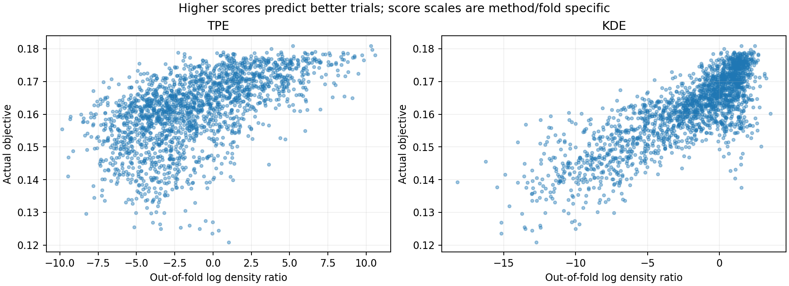
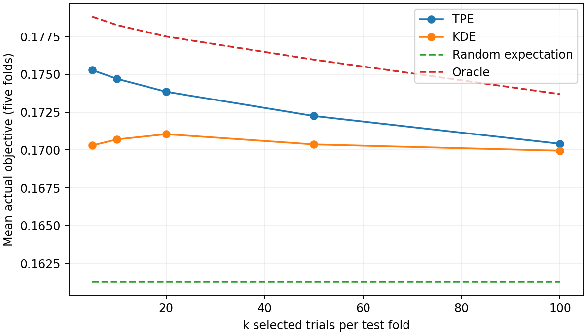

# Optuna TPE und statsmodels KDE: empirischer Vergleich

**Robustheitsprüfung vom 23. Oktober 2026:** Der [Bericht für fünf Startwerte und
zwei Studien](robustness/README.md) dokumentiert 100 erfolgreiche Fits, praktisch
identische Rankings und die Grenzen einer allgemeinen Nutzung in Lighthouse.

**Aktualisierung vom 23. Oktober 2026:** Der reparierte Drei-Verfahren-Vergleich
steht im [neuen Ergebnisbericht](bounded_loo/README.md), einschließlich erfolgreicher
Bandbreitenoptimierung und Score-Dezil-Kurven. Für das primäre Ziel der
Score-Performance-Beziehung lautet die Empfehlung dort **optimierte KDE**.
Der folgende Bericht bewahrt den ersten Versuch; seine Reproduktionsbefehle
beziehen sich auf die damalige Skriptschnittstelle. Aktuelle Befehle stehen im
neuen Bericht.

Durchgeführt am 22. Oktober 2026. Das ausführbare Experiment steht in
[benchmark_tpe_kde.py](../../../examples/api/benchmark_tpe_kde.py), die gezielten
Tests in [test_tpe_kde_benchmark.py](../../../tests/test_tpe_kde_benchmark.py).

**Ergebnis:** TPE liefert die besseren Top-20-Konfigurationen (0,17385 gegenüber
0,17104); KDE erzielt die höhere globale Rangkorrelation (0,77186 gegenüber
0,62228). Für die Priorisierung weniger neuer Trials empfehle ich hier TPE.

## Daten und Versuchsaufbau

Verwendet wurde die bereits über `compose.yaml` an DeepCAVE angebundene Datenbank
`../streamingmodel_NonRouterHHs/optuna.db`, Studie:

```text
xgboost_data:4897daef3195_average_precision_v1_sampler:random_objective:cv_average_precision_mean_direction:maximize_modelseed:42_cvseed:42
```

Die Studie enthält genau **2.000 abgeschlossene Trials mit endlichen Werten**,
2.000 unterschiedliche Konfigurationen und das Maximierungsziel
`cv_average_precision_mean`. Das gespeicherte Studienattribut `sampler="random"`
belegt die deklarierte Samplingstrategie; eine zusätzliche Kennzeichnung pro
Trial existiert nicht. Der beim Laden von Optuna eingesetzte Standardsampler
wird ausdrücklich nicht als Beleg für die ursprüngliche Strategie verwendet.

Der Suchraum hat zehn Parameter: sieben kontinuierliche und drei ganzzahlige.
Alle zehn sind in allen Trials aktiv, ihre Distributionen sind unverändert.
Es gibt keine inaktiven Parameter, keine Imputation und keinen reduzierten Teilraum.
Parametergrenzen, Schritte und Typen stehen vollständig in den jeweiligen
`metadata.json`-Dateien unter `activity_audit`.

| Parameter | Typ / Grenzen | KDE-Darstellung |
|---|---|---|
| colsample_bytree | Float, 0,5–1 | kontinuierlich, auf [0,1] skaliert |
| gamma | Float, 0,0001–10, logarithmisch | log-transformiert, auf [0,1] skaliert |
| learning_rate | Float, 0,005–0,3, logarithmisch | log-transformiert, auf [0,1] skaliert |
| max_delta_step | Integer, 0–10, Schritt 1 | geordneter diskreter Kernel |
| max_depth | Integer, 3–12, Schritt 1 | geordneter diskreter Kernel |
| min_child_weight | Float, 0,5–100, logarithmisch | log-transformiert, auf [0,1] skaliert |
| n_estimators | Integer, 200–2.000, Schritt 50 | geordneter diskreter Kernel, Gitterindex |
| reg_alpha | Float, 0,0001–10, logarithmisch | log-transformiert, auf [0,1] skaliert |
| reg_lambda | Float, 0,01–100, logarithmisch | log-transformiert, auf [0,1] skaliert |
| subsample | Float, 0,5–1 | kontinuierlich, auf [0,1] skaliert |

Fünf Folds mit Seed **42** enthalten jeweils 400 Test- und 1.600 Trainingstrials.
Konfigurationen werden unabhängig von ihren Objective-Werten gemischt und als
Gruppen einem möglichst kleinen Fold zugewiesen. Identische Konfigurationen
bleiben auch bei anderen Eingabestudien zusammen. In jedem Fold bilden die
besten **320 Trainingstrials** `good`, die übrigen **1.280** `bad`.
Bei anderen Stichprobengrößen wird `ceil(0.2 * n_train)` verwendet.

Die Objective-Werte des Test-Folds werden ausschließlich für die anschließende
Evaluation verwendet. Distributionen und Grenzen stammen aus dem deklarierten
Suchraum; diese Metadaten werden nicht aus Test-Objectives geschätzt.
Die Pilotstichprobe enthält 200 Trials, ohne Verwendung ihrer Objective-Werte
mit Seed 42 ausgewählt. Pilot und Hauptlauf haben eigene Folds; Pilotmetriken
sind daher keine direkt gepaarte Vergleichsreihe zum Hauptlauf.

## Modelle und numerische Behandlung

**TPE:** Tatsächlich installiertes Optuna **3.6.1**, interne `_ParzenEstimator`-API,
isoliert in `OptunaParzenAdapter`. Verwendet wird die multivariate gemeinsame
Mischverteilung, einschließlich der tatsächlichen Optuna-Distributionen,
`consider_prior=True`, `prior_weight=1`, `consider_magic_clip=True`,
`consider_endpoints=False`. Alle Beobachtungen haben gleiche Gewichte; die bei
adaptiven Studien übliche zeitliche Gewichtung wird hier nicht benutzt.
Die Good/Bad-Aufteilung erfolgt extern mit 20/80, ohne Optunas Standard-`gamma`
oder dessen Beschränkung der Good-Gruppe. Es werden keine neuen Trials erzeugt.
Optuna kennzeichnet seine multivariate Option als experimentell.

**KDE:** statsmodels **0.14.6**, `KDEMultivariate`, gemeinsame Produktkern-Mischung
mit separatem Fit für `good` und `bad`. Kontinuierliche Parameter verwenden
Gauß-Kernel, geordnete diskrete Parameter Wang-Ryzin-Kernel. Ein Produktkern
pro Beobachtung impliziert keine Unabhängigkeit der gemeinsamen Mischdichte.
Die im Skript ebenfalls unterstützten Kategorien verwenden ungeordnete
Aitchison-Aitken-Kernel (`u`), keine numerischen Abstände. Im realen Datensatz
gibt es keine Kategorien; deren Unterstützung ist durch gezielte Tests,
aber nicht durch diesen empirischen Benchmark abgedeckt.

Für beide Modelle gilt `score = log l(x) - log g(x)`. Bei KDE wird die mathematisch
gleiche statsmodels-Dichte direkt im Lograum mit `logsumexp` ausgewertet.
Die Übereinstimmung mit `KDEMultivariate.pdf` bei gemischten Datentypen und die
Stabilität bei einem im normalen Zahlenraum unterlaufenden `pdf` sind getestet.
Es werden keine Dichtequotienten dividiert und keine PDF-Werte abgeschnitten.
Die KDE-Bandbreiten erhalten eine Untergrenze von `1e-8` und diskrete Bandbreiten
eine Obergrenze von `1-1e-8`, damit degenerierte Kernelgrenzen keine unendlichen
Scores erzeugen. Rohe und verwendete Bandbreiten werden vollständig gespeichert.

Die primäre Bandbreitenwahl ist das integrierte **`cv_ml`** mit den
statsmodels-Standardeinstellungen. Es nutzt nur die betreffende Trainingsgruppe.
Nach **45 Sekunden je Good- oder Bad-Fit** erfolgt ein explizit protokollierter
Rückfall auf `normal_reference`. Dessen Zeit ist einschließlich des abgebrochenen
CV-Versuchs erfasst. Ein zusätzlicher vollständiger Lauf verwendet von Beginn an
`normal_reference`, um die recheneffiziente Alternative separat zu bewerten.
Die Varianten sind vorab festgelegt; es gibt keine Auswahl von Bandbreiten anhand
von Test-Objectives.

statsmodels optimiert `cv_ml` intern ohne beschränkten Suchpfad und korrigiert
die Bandbreitengrenzen anschließend. Dabei beobachtete Warnungen und zusätzliche
Regularisierungen stehen in `metadata.json`. Die öffentliche Schnittstelle
liefert keinen Konvergenzstatus; das Ende eines Fits ist daher kein Nachweis eines
globalen oder auch nur erfolgreichen lokalen Optimums.

## Ergebnisse

**Empfehlung für Coverage-Guided Trial Generation: TPE als Voreinstellung zur
Priorisierung weniger besonders guter Kandidaten.** KDE eignet sich hier besser
für die globale Rangordnung. Diese beiden Aussagen betreffen unterschiedliche
Ziele und werden durch die beiden angeforderten Metriken getrennt sichtbar.

Alle Werte sind Mittelwerte über fünf Test-Folds; die Spearman-SD ist die
Stichprobenstandardabweichung (`ddof=1`). Höhere Objective-Werte sind besser.
Die folgende Tabelle verwendet den vollständigen CV-Versuch einschließlich
seiner ausdrücklich dokumentierten Rückfälle:

| Metrik | Optuna TPE | statsmodels KDE, effektiv Normalreferenz |
|---|---:|---:|
| Mean Spearman ρ | 0,622278 | 0,771863 |
| SD Spearman ρ | 0,027198 | 0,026905 |
| Mean Objective @ Top 20 | **0,17385110** | 0,17104363 |
| Random-Baseline | 0,16128325 | 0,16128325 |
| Oracle @ Top 20 | 0,17750014 | 0,17750014 |
| Improvement over Random, absolut | **+0,01256785** | +0,00976038 |
| Improvement over Random, relativ | **+7,79 %** | +6,05 % |
| Fit-Zeit, Summe über fünf Folds | 0,00154 s | 325,33031 s |
| Scoring-Zeit, Summe über fünf Folds | 1,44959 s | 0,07749 s |
| Fit + Scoring, Summe | 1,45113 s | 325,40780 s |

**CV-Diagnose:** In allen fünf Good-Gruppen endete `cv_ml` nach etwa 19,6–20,6 s.
Dabei trat jeweils `invalid value encountered in log` auf. Die zurückgegebenen
Bandbreiten waren nach Grenzkorrektur **exakt gleich** den normalreferenzbasierten
Bandbreiten. Die drei diskreten Ausgangsbandbreiten liegen über 1, beispielsweise
im ersten Good-Fit bei 2,2243, 1,4099 und 6,9938. Der unbeschränkte Optimierer
startet damit außerhalb des zulässigen Kernelbereichs. Dieser Versuch erreichte
keine wirksame CV-Optimierung; ein ohne Ausnahme beendeter Fit wird deshalb
ausdrücklich nicht als erfolgreiche Bandbreitenoptimierung bewertet.

Alle fünf Bad-Fits wurden nach jeweils 45 s abgebrochen und verwendeten die
Normalreferenzregel. Die effektiven Bandbreiten und **sämtliche 2.000 OOF-Scores
beider Verfahren** sind zwischen CV-Versuch und zusätzlichem schnellem Lauf exakt
gleich. Es handelt sich daher nicht um zwei verschiedene empirische
Rankingresultate. Bei allen zehn KDE-Fits wurden diskrete Bandbreiten korrigiert;
auch der schnelle Lauf ist eine ausdrücklich regularisierte Normalreferenz-KDE.

Die recheneffiziente Variante ist tatsächlich vollständig ausgeführt:

| Reiner Normalreferenz-Lauf | Optuna TPE | statsmodels KDE |
|---|---:|---:|
| Fit-Zeit, Summe | 0,00148 s | 0,00074 s |
| Scoring-Zeit, Summe | 1,49416 s | 0,08032 s |
| Fit + Scoring, Summe | 1,49563 s | **0,08106 s** |

KDE ist mit dieser Bandbreitenregel in der vorliegenden Implementierung beim
Scoring deutlich schneller. Der Lograum-Scorer ist blockweise vektorisiert;
die Zeiten vergleichen die tatsächlich implementierten Wege und sind kein
allgemeiner Komplexitätsvergleich der Bibliotheken. Die ersten Sekunden beider
Voll-Läufe überschnitten sich; die Prozesse verwendeten jeweils einen
BLAS-/OpenMP-Thread. Die Größenordnung der CV-Kosten ist eindeutig, feinste
Laufzeitunterschiede sind nicht als belastbares Mikrobenchmarkresultat zu lesen.

### Top-k und Visualisierungen

Top-k wird **innerhalb jedes Test-Folds** ausschließlich nach seinem OOF-Score
ausgewählt, dann über die fünf Folds gemittelt. Die Random-Linie ist die exakte
Erwartung einer gleichverteilten zufälligen Auswahl, also der Fold-Mittelwert.
Das Oracle darf zur Referenz die Test-Objectives sortieren. Gleichstände bei
modellbasiertem Top-k werden nach aufsteigender Trial-Nummer entschieden.

| k pro Test-Fold | Optuna TPE | statsmodels KDE | Random | Oracle |
|---:|---:|---:|---:|---:|
| 5 | **0,17527903** | 0,17029901 | 0,16128325 | 0,17880866 |
| 10 | **0,17470457** | 0,17069756 | 0,16128325 | 0,17826266 |
| 20 | **0,17385110** | 0,17104363 | 0,16128325 | 0,17750014 |
| 50 | **0,17224723** | 0,17036763 | 0,16128325 | 0,17597221 |
| 100 | **0,17040904** | 0,16995249 | 0,16128325 | 0,17369168 |





Die Scatterplots zeigen alle OOF-Scores. Die absoluten Scorehöhen zwischen
Verfahren und Folds sind nicht kalibriert und werden nicht verglichen. Alle
berichteten Spearman-Werte und Auswahlen werden foldweise berechnet; es wird
keine globale Rangliste aus unkalibrierten Fold-Scores gebildet.

### Einordnung für Lighthouse

TPE erreicht bei Top 20 einen um **0,00280747** höheren mittleren Objective-Wert
als KDE und gewinnt diesen gepaarten Vergleich in vier der fünf Folds. Auch
bei k = 5, 10, 50 und 100 ist der über die Folds gemittelte Objective-Wert höher.
Das passt zum Ziel, aus einem vorhandenen Kandidatenvorrat wenige besonders
leistungsfähige Konfigurationen für weitere Trials zu priorisieren. Die niedrigere
Spearman-Korrelation zeigt zugleich, dass TPE die breite Population weniger
zuverlässig ordnet. Für eine flächige Rangordnung vorhandener Konfigurationen
ist die schnelle KDE-Variante in diesem Datensatz die bessere Wahl.

TPE-Fits sind sehr günstig und behandeln die tatsächlichen diskreten, begrenzten
und logarithmischen Optuna-Distributionen unmittelbar. Der technische Nachteil
ist die private Optuna-API; der kleine Adapter und die festgehaltene Version
begrenzen diesen Wartungsbedarf. KDE hat eine öffentliche Fit-API und hier den
schnelleren Scorer. Für gemischte Suchräume erfordert sie jedoch explizite
Transformationen, Bandbreitenregularisierung, Schutz gegen PDF-Unterlauf und
Prüfung der Kategorieunterstützung. Die beobachtete CV-Instabilität spricht gegen
`cv_ml` mit den unveränderten statsmodels-Standardeinstellungen als Standardweg
für diesen Suchraum. Die Normalreferenzregel ist eine praktikable, schnelle
Alternative, erreicht hier aber die schlechtere Top-20-Qualität.

Die Empfehlung gilt für **diese Studie und diese Modellkonfigurationen**. Sie ist
kein genereller Nachweis einer Überlegenheit aller TPE- gegenüber allen
KDE-Varianten. Insbesondere wurde keine erfolgreich optimierte `cv_ml`-KDE mit
gültiger Initialisierung untersucht. Es wurde ein vorhandener Random-Trial-Pool
bewertet, keine Coverage-gesteuerte sequentielle Optimierung neuer Trials.
Die Studie liefert Evidenz für die Kandidatenpriorisierung, aber keinen direkten
Nachweis eines Coverage- oder Online-HPO-Gewinns. Die Folds teilen sich große
Teile der Trainingsdaten; ihre Streuung ersetzt keinen Signifikanztest.

Der Pilot lief tatsächlich mit 200 Trials und zehn beendeten `cv_ml`-Aufrufen:
KDE-Fitzeit 34,41588 s, ebenfalls Warnungen und Bandbreitenregularisierung.
Spearman betrug TPE 0,36113 / KDE 0,67700, Top 20 TPE 0,16490636 / KDE 0,16778964.
Er diente der API- und Laufzeitprüfung und bestimmt die Empfehlung nicht.
**13 gezielte Tests** bestehen, einschließlich Leakage-Prüfung durch Permutation
der Test-Objectives, gruppierter Fold-Zuordnung, Minimierung, gemischter
KDE-Kernel, numerischer Stabilität, Timeout-Rückfall und unveränderter
SQLite-Quelldatei. Die vollständige DeepCAVE-Testsuite wurde nicht ausgeführt.

## Artefakte und Reproduktion

Jeder Ergebnisordner enthält:

- `oof_scores.csv`: Trial-Nummer als stabile ID innerhalb der benannten Studie,
  tatsächlicher Objective-Wert, Fold-ID, beide Scores und vollständige Parameter.
  Datenbankinterne IDs werden beim Entkoppeln von Optuna neu vergeben und deshalb
  nicht als vermeintlich ursprüngliche Trial-IDs ausgegeben.
- `fold_metrics.csv`, `summary.csv`: Einzel-Fold-Werte und aggregierte Metriken.
- `timings.csv`: Fit- und Scoring-Wandzeit pro Verfahren und Fold, ohne Datenladen,
  Importe, CSV-Ausgabe oder Plot-Erstellung; keine exklusiv reservierte Hardware.
- `top_k.csv`: Top-k-Objective, Random-Erwartung und Oracle je Fold und Verfahren.
- `metadata.json`: Versionen, Suchraumaudit, Konfiguration, Bandbreiten, Warnungen,
  Rückfälle und SHA-256 der vollständigen ausgewählten Eingabetrials.
- `score_vs_objective.png`, `top_k.png`: die beiden angeforderten Visualisierungen.

Die Eingabedatenbank wird nur lesend geöffnet und per SQLite-Backup konsistent
kopiert. Optuna arbeitet anschließend mit dieser temporären Kopie und einem
entkoppelten In-Memory-Snapshot. Bestehende Lighthouse-/DeepCAVE-Funktionen wurden
nicht verändert. Zusätzlich installiert wurden nur statsmodels 0.14.6 und dessen
fehlende Abhängigkeit patsy 1.0.3. Weitere Laufzeitversionen: NumPy 2.2.6,
SciPy 1.15.3, Matplotlib 3.9.0, Python 3.10.

Aus dem Repository-Stamm:

```bash
export UV_CACHE_DIR=/tmp/codex-uv-cache
export MPLCONFIGDIR=/tmp/tpe-kde-mpl
export OPENBLAS_NUM_THREADS=1 OMP_NUM_THREADS=1

# Falls die optionale Benchmark-Abhängigkeit noch fehlt:
uv pip install --python .venv/bin/python statsmodels==0.14.6

BENCHMARK_STUDY='xgboost_data:4897daef3195_average_precision_v1_sampler:random_objective:cv_average_precision_mean_direction:maximize_modelseed:42_cvseed:42'

uv run --locked python examples/api/benchmark_tpe_kde.py \
  --source ../streamingmodel_NonRouterHHs/optuna.db \
  --study-name "$BENCHMARK_STUDY" \
  --output docs/validation/tpe_kde/pilot --limit 200 --bandwidth-timeout 15

uv run --locked python examples/api/benchmark_tpe_kde.py \
  --source ../streamingmodel_NonRouterHHs/optuna.db \
  --study-name "$BENCHMARK_STUDY" \
  --output docs/validation/tpe_kde/full_cv_ml --bandwidth-timeout 45

uv run --locked python examples/api/benchmark_tpe_kde.py \
  --source ../streamingmodel_NonRouterHHs/optuna.db \
  --study-name "$BENCHMARK_STUDY" \
  --output docs/validation/tpe_kde/full_normal_reference --bandwidth normal_reference

uv run --locked pytest tests/test_tpe_kde_benchmark.py -q -o addopts=''
```

Alternativ akzeptiert `--source` einen vertrauenswürdigen bestehenden
`optuna_study.pkl` oder dessen Verzeichnis; `--study-name` entfällt dann.
Bei bedingten oder wechselnden Distributionen bricht der Standardmodus mit
konkreten Parameternamen ab. `--subspace intersection` erlaubt ausdrücklich nur
die gemeinsamen Parameter mit unveränderter Distribution für beide Modelle.
Auch dann bleiben identische Projektionen in einem Fold; das dokumentierte
Ergebnis gilt ausschließlich für diesen Teilraum.

Weitere ausdrücklich behandelte Grenzen: Multi-Objective-Studien werden
abgelehnt; jeder Test-Fold braucht mindestens 20 Trials. Eine KDE-Trainingsgruppe
muss mehr Beobachtungen als Dimensionen und alle deklarierten Kategorien enthalten,
da statsmodels die Kategorienanzahl aus ihren Beobachtungen ableitet. Fehlende
Kategorien werden mit konkretem Fehler gemeldet, nicht durch Konstanten ergänzt.
Logarithmische Integer-Distributionen verwendet das allgemeine Skript als
kontinuierliche Log-Approximation und dokumentiert dies in den Transformationen;
sie kommen in diesem Benchmark nicht vor. Das Zeitlimit benutzt POSIX-Signale
und setzt den Hauptthread voraus.
