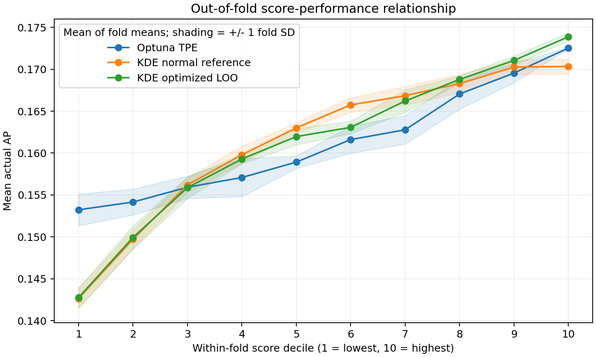

# Reparierte KDE-Optimierung und Score-Performance-Beziehung

Durchgeführt am **23. Oktober 2026**. **Für das Ziel „höherer Score bedeutet im
Mittel höhere tatsächliche AP“ empfehle ich in dieser Studie die optimierte KDE.**
Ihre Bandbreiten wurden erfolgreich auf den vollständigen Trainingsgruppen
optimiert. Sie erreicht höhere Rangkorrelationen und weniger fallende
Dezilübergänge als TPE und die bisherige KDE-Baseline.

## Vergleich auf unveränderten Daten

Dieselbe XGBoost-Random-Studie mit 2.000 abgeschlossenen, endlichen Trials,
zehn durchgehend aktiven Parametern und Maximierungsziel
`cv_average_precision_mean`. Seed 42, fünf identische Folds mit jeweils 400 Test-
und 1.600 Trainingstrials; `good` sind die besten 320 Trainingstrials, `bad` die
übrigen 1.280. Die vorherigen Konfigurationen, Objectives und Fold-Zuordnungen
wurden gegen die alte OOF-CSV geprüft. Auch der Eingabe-SHA-256 ist unverändert.
**Alle TPE- und Normalreferenz-Scores sind exakt identisch zum ersten Benchmark.**
TPE-Konfiguration, Transformationen und Kerneltypen bleiben unverändert.

| Metrik | Optuna TPE | KDE Normalreferenz | KDE optimiert |
|---|---:|---:|---:|
| Mean Spearman ρ | 0,622278 | 0,771863 | **0,848413** |
| SD Spearman ρ über fünf Folds | 0,027198 | 0,026905 | **0,015365** |
| Fallende Übergänge der aggregierten Dezilkurve, von 9 | 0 | 0 | 0 |
| Fallende Dezilübergänge innerhalb der Folds, von 45 | 8 | 4 | **1** |
| Kleinster AP-Zuwachs zwischen aggregierten Nachbardezilen | +0,000924 | +0,000078 | +0,001102 |
| Fit-Zeit, alle fünf Folds | 0,0015 s | 0,0008 s | 8,1737 s |
| Scoring-Zeit, alle fünf Folds | 1,4234 s | 0,0757 s | 0,0760 s |
| Mean AP @ Top 20, ergänzend | 0,173851 | 0,171044 | 0,174280 |

Die optimierte KDE übertrifft beide Alternativen bei Spearman **in jedem der
fünf Folds**. Top 20 ist ein ergänzendes Ergebnis und bestimmt die Empfehlung
nicht. Zeiten sind Wandzeiten ohne Laden, Importe, Berichterstellung und Plots,
mit jeweils einem BLAS-/OpenMP-Thread; sie sind kein dedizierter Hardwarevergleich.

## Primärer Plot: Score-Dezile und tatsächliche AP

Innerhalb jedes Test-Folds werden die 400 Konfigurationen nach ihrem jeweiligen
OOF-Score aufsteigend sortiert und in zehn Gruppen mit **je 40 Trials** geteilt.
Anschließend werden die fünf AP-Mittelwerte eines Dezils gemittelt. Absolute
Scorehöhen zwischen Verfahren oder Folds werden weder gepoolt noch verglichen.



[Vektorgrafik](score_performance_deciles.svg) ·
[aggregierte Dezilwerte](decile_summary.csv) ·
[alle Fold-Dezilwerte und Scoregrenzen](decile_metrics.csv)

| Score-Dezil | TPE: mittlere AP | Normalreferenz: mittlere AP | Optimiert: mittlere AP |
|---:|---:|---:|---:|
| 1, niedrigste Scores | 0,153235 | 0,142654 | 0,142770 |
| 2 | 0,154160 | 0,149713 | 0,149945 |
| 3 | 0,155929 | 0,156203 | 0,155874 |
| 4 | 0,157086 | 0,159801 | 0,159292 |
| 5 | 0,158922 | 0,163004 | 0,161967 |
| 6 | 0,161610 | 0,165742 | 0,163069 |
| 7 | 0,162774 | 0,166845 | 0,166210 |
| 8 | 0,167046 | 0,168284 | 0,168782 |
| 9 | 0,169545 | 0,170254 | 0,171054 |
| 10, höchste Scores | 0,172525 | 0,170333 | 0,173869 |

**Die aggregierten Kurven aller drei Verfahren sind streng monoton.** Ihre
Dezil-Rangkorrelation ist deshalb jeweils 1 und allein kein geeignetes
Unterscheidungskriterium. Die optimierte KDE trennt die schwachen und starken
Konfigurationen deutlicher als TPE und vermeidet das fast flache obere Ende
der Normalreferenz-Kurve. Noch aussagekräftiger sind die Rangkorrelationen auf
den einzelnen Trials und die Monotonie innerhalb der Folds: Die optimierte KDE
hat nur bei **Fold-ID 2, Dezil 5 → 6** einen Rückgang um 0,000556 AP. Vier ihrer
fünf Fold-Kurven sind vollständig monoton; bei TPE ist es eine von fünf.
Die Schattierungen zeigen ± eine Standardabweichung der fünf Fold-Mittelwerte,
keine Konfidenzintervalle. Bessere Kurven bedeuten eine bessere Zuordnung von
Konfigurationen zu Performancebereichen, keine Veränderung ihrer Objectives.

## Reparatur und Nachweis einer tatsächlichen Optimierung

Die bisherige statsmodels-Initialisierung setzt auch für Integer-Parameter
`1.06 * std(data) * n**(-1/(4+d))` ein. Deren Werte können über 1 liegen, obwohl
der Wang-Ryzin-Kernel diskrete Bandbreiten im Bereich [0,1] benötigt. Der interne
Nelder-Mead-Optimierer beschränkt den Suchpfad nicht und korrigiert Grenzen erst
nachträglich. Mit den drei ungültigen diskreten Startwerten entstanden negative
Produktkernelwerte und damit ungültige Log-Likelihoods.

Die Reparatur im [bestehenden Benchmarkskript](../../../../examples/api/benchmark_tpe_kde.py)
verwendet weiterhin **statsmodels 0.14.6 `KDEMultivariate` und dieselben Kernel**:

- SciPy `L-BFGS-B` minimiert die exakte mittlere negative Leave-one-out-
  Log-Likelihood separat für jede Good- und Bad-Gruppe. Alle 320 bzw. 1.280
  Beobachtungen werden benutzt; es gibt keine Subsamples oder Surrogatmodelle.
- Kontinuierliche Bandbreiten werden im Lograum parametrisiert, mit Grenzen
  [0,000001; 10] in den bereits auf [0,1] transformierten Koordinaten. Ihre
  Startwerte stammen aus der Normalreferenzregel, für allgemeine Eingaben auf
  [0,00001; 1] beschränkt; hier waren sie bereits gültig.
- Diskrete Bandbreiten starten bei **0,5** und bleiben während der gesamten
  Optimierung in [0,000001; 0,999999]. Finale Werte werden **nicht** abgeschnitten.
- Zwischengespeicherte paarweise Distanzen, Logsumexp und ein analytischer
  Gradient beschleunigen dieselbe LOO-Likelihood. Die Diagonale wird ausgeschlossen;
  jede Dichte enthält den Faktor `1/(n-1)`. statsmodels lässt diesen für die
  Optimierung konstanten Faktor in `loo_likelihood` weg; beim Vergleich wird er
  berücksichtigt. Gleichheit und Gradient werden gezielt getestet.
- Ein Timeout oder fehlende Konvergenz wird ausdrücklich als Fehlschlag
  protokolliert. Der Benchmark akzeptiert einen optimierten Fit nur bei positivem
  Likelihood-Fortschritt, veränderten Bandbreiten und erfolgreichem Optimierungsstatus.
  Es gibt **keinen Rückfall auf Normalreferenz**.

Zunächst wurde der ursprüngliche Fold 0 vollständig ausgeführt
([Pilotartefakte](../bounded_pilot/summary.csv)), anschließend alle fünf Folds.
**Alle zehn Fits konvergierten mit Status 0**, nach 17–28 Iterationen und 21–33
Funktions-/Gradientenauswertungen. Kein finaler Wert liegt auf einer Grenze;
kein Fit lief ins Zeitlimit. Die gesamte Optimierung benötigte rund **8,17 s**.

| Fold-ID | Gruppe | Initiale mittlere LOO-Log-Likelihood | Finale mittlere LOO-Log-Likelihood |
|---:|---|---:|---:|
| 0 | good | −9,962789 | −9,417353 |
| 0 | bad | −10,594479 | −10,238252 |
| 1 | good | −10,046870 | −9,486683 |
| 1 | bad | −10,606939 | −10,242937 |
| 2 | good | −9,943820 | −9,416771 |
| 2 | bad | −10,604946 | −10,235958 |
| 3 | good | −10,060876 | −9,512980 |
| 3 | bad | −10,556306 | −10,207215 |
| 4 | good | −9,963982 | −9,449112 |
| 4 | bad | −10,618074 | −10,240819 |

Die folgenden Bandbreiten zeigen die Integer-Parameter im ursprünglichen Fold 0:

| Parameter | Gültiger Start, good/bad | Final good | Final bad |
|---|---:|---:|---:|
| max_delta_step | 0,5 | 0,609877 | 0,611048 |
| max_depth | 0,5 | 0,502293 | 0,511479 |
| n_estimators | 0,5 | 0,831008 | 0,828468 |

Über alle Fits liegen die finalen Integer-Bandbreiten zwischen **0,472249 und
0,837517**. Die kontinuierlichen Bandbreiten wurden ebenfalls optimiert.
[optimization_diagnostics.json](optimization_diagnostics.json) enthält für
jeden Fit alle initialen und finalen Bandbreiten, Grenzen, Status, Abbruchmeldung,
Iterationszahl, mittlere und summierte LOO-Log-Likelihood und Laufzeit; dieselben
Informationen werden während des Laufs ausgegeben.

Die finalen Modelle sind lokale, erfolgreich konvergierte Lösungen; ein globales
Optimum wird nicht behauptet. Die Distanz-Caches benötigen O(d·n²) Speicher,
für die zehn Dimensionen der Bad-Gruppe rund 125 MiB allein für die Merkmale.
Bei wesentlich größeren Studien kann das eine Grenze darstellen.

## Verifikation und Reproduktion

**16 gezielte Tests bestehen**, unter anderem für Likelihood-Identität,
Gradientenprüfung, gültige Startwerte, tatsächlichen Optimierungsfortschritt,
fehlenden Fallback und die Unabhängigkeit aller drei Scores von den Test-Objectives.
Zusätzlich wurden die realen zehn Fits bei jeweils initialen und finalen
Bandbreiten direkt mit der nativen statsmodels-LOO-Funktion verglichen
([Verifikationsprotokoll](verification.json)). Sämtliche Rangkorrelationen und
alle 150 Fold-/Verfahren-/Dezilmittelwerte wurden unabhängig aus der OOF-CSV
nachgerechnet. Keine Lighthouse-Oberflächen- oder Produktfunktion wurde verändert.

```bash
export UV_CACHE_DIR=/tmp/codex-uv-cache
export MPLCONFIGDIR=/tmp/tpe-kde-mpl
export OPENBLAS_NUM_THREADS=1 OMP_NUM_THREADS=1
BENCHMARK_STUDY='xgboost_data:4897daef3195_average_precision_v1_sampler:random_objective:cv_average_precision_mean_direction:maximize_modelseed:42_cvseed:42'

uv run --locked python examples/api/benchmark_tpe_kde.py \
  --source ../streamingmodel_NonRouterHHs/optuna.db \
  --study-name "$BENCHMARK_STUDY" \
  --reference-oof docs/validation/tpe_kde/full_normal_reference/oof_scores.csv \
  --output docs/validation/tpe_kde/bounded_loo --bandwidth-timeout 120

# Für den Vorversuch ergänzen: --fold 0
# und --output docs/validation/tpe_kde/bounded_pilot verwenden.
uv run --locked pytest tests/test_tpe_kde_benchmark.py -q -o addopts=''
```

[OOF-CSV mit allen drei Scores](oof_scores.csv) · [Fold-Metriken](fold_metrics.csv) ·
[Vergleichstabelle als CSV](summary.csv) · [Laufzeiten](timings.csv) ·
[Versuchsmetadaten](metadata.json) · [ergänzende Top-k-Kurve](top_k.png)

**Geltungsbereich:** Der Befund unterstützt eine zuverlässigere Score-Performance-
Beziehung für neue Konfigurationen aus einer vergleichbaren Verteilung **dieses
Suchraums**. Er garantiert weder eine monotone Beziehung für jede einzelne
Konfiguration noch extrapolative Verlässlichkeit außerhalb der beobachteten
Verteilung. Der Score ist keine kalibrierte AP-Vorhersage. Es wurde eine Studie
mit überlappenden CV-Trainingsmengen untersucht, kein allgemeiner
Überlegenheitsnachweis über mehrere Aufgaben oder ein Online-HPO-Gewinn.
