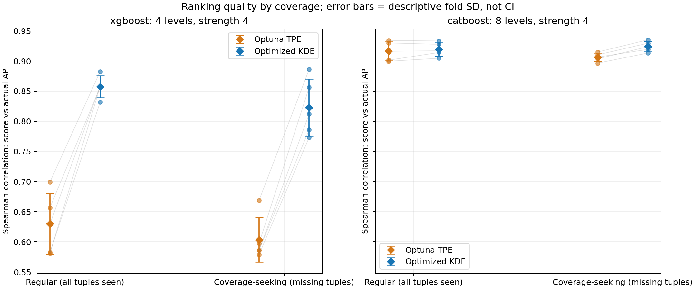
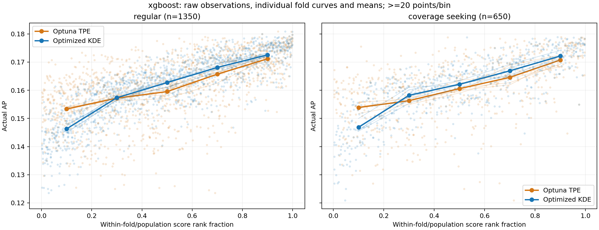
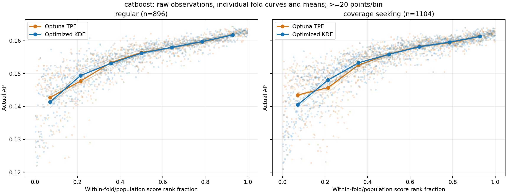

# Lighthouse: KDE und TPE in Coverage-Lücken

**Phase A vollständig ausgeführt am 23. Oktober 2026.** Die KDE behält auch in
Coverage-seeking-Regionen die höhere mittlere AP-Rangkorrelation. Bei XGBoost
nimmt ihre Qualität gegenüber Regular leicht ab; bei CatBoost bleibt sie erhalten.
**Phase B ist vorbereitet, aber mangels nutzbarer GPU nicht trainiert.**

Das primäre Kriterium bleibt: **Je höher der Score, desto höher soll im
statistischen Mittel die tatsächliche AP sein.** Top-k wurde nicht ausgewertet.

## Zentrale Ergebnisse

ρ ist der Mittelwert der fünf Fold-Korrelationen auf identischen Testkonfigurationen.
Absolute Scores verschiedener Folds werden nicht gepoolt.

| Studie | Testpopulation | KDE Spearman ρ | TPE Spearman ρ | Anzahl evaluiert |
|---|---|---:|---:|---:|
| XGBoost | Regular, retrospektiv | 0,857 | 0,630 | 1.350 |
| XGBoost | Coverage-seeking, retrospektiv | 0,823 | 0,603 | 650 |
| XGBoost | Coverage-seeking, prospektiv | nicht ausgeführt | nicht ausgeführt | 0; 25 vorbereitet |
| CatBoost | Regular, retrospektiv | 0,919 | 0,916 | 896 |
| CatBoost | Coverage-seeking, retrospektiv | 0,924 | 0,906 | 1.104 |
| CatBoost | Coverage-seeking, prospektiv | nicht ausgeführt | nicht ausgeführt | 0; 25 vorbereitet |

Punkte: einzelne Folds. Balken: deskriptive Fold-SD, **keine Konfidenzintervalle**.
Graue Linien verbinden die gepaarten Verfahrenswerte.
[CSV](comparison.csv) · [SVG](ranking_by_coverage.svg)

## Welche Coverage-Lücken wurden geprüft?

Die bisherigen fünf Folds bleiben unverändert: je 1.600 historische und 400
Test-Trials. Beide Methoden, ihre Transformationen und die gemeinsame
20/80-Aufteilung bleiben unverändert. Alle bisherigen OOF-Scores werden exakt
reproduziert. Keine neue HPO und keine Änderungen an der Lighthouse-Oberfläche.

Die Gruppeneinteilung verwendet ausschließlich die historischen Konfigurationen
und die vorhandenen Lighthouse-Funktionen `CoverageSpec` und `CoverageState`:

- **Coverage-seeking:** schließt mindestens eine bisher fehlende Kombination.
- **Regular:** alle projizierten Kombinationen sind vorhanden. Das bedeutet
  nicht automatisch, dass jede davon häufig beobachtet wurde.
- **Selten, aber vorhanden:** Belegung 1–5, separat von vollständig fehlenden
  Kombinationen untersucht.

Sechs Sichten wurden ausgewertet: Auflösungen 4 und 8 mit Strength 2, 3 und 4.
Eine ausschließlich auf Trainings-Coverage und theoretischen Referenzpunkten
beruhende Regel wählt die primäre Sicht: **4/4 für XGBoost, 8/4 für CatBoost**.
Objectives und KDE-/TPE-Scores beeinflussen diese Wahl nicht.
Die vollständigen Auswahlregeln und Sensitivitätsergebnisse stehen im
[ausführlichen Versuchsprotokoll](DETAILS.md).

## Score-Performance-Beziehung und Stabilität

Die Abbildungen zeigen Einzelbeobachtungen, Fold-Kurven und deren Mittelwerte.
Regular und Coverage-seeking verwenden innerhalb jeder Studie dieselbe Auflösung:
**fünf Scoregruppen bei XGBoost, sieben bei CatBoost**, mindestens 20 Punkte pro
Gruppe. Für zu kleine Gruppen wird keine Kurve erzeugt.

KDE ist in allen primären Gruppen auf allen fünf Fold-Kurven monoton. TPE ist
in beiden Coverage-seeking-Gruppen ebenfalls monoton; bei XGBoost/Regular sind
es vier von fünf Kurven. Die gröbere Gruppierung allein trennt die Verfahren
somit wenig. Rangkorrelationen und Einzelbeobachtungen bleiben entscheidend.
Die AP-Spreizung zwischen höchster und niedrigster Scoregruppe beträgt bei
Coverage-seeking 0,02531 versus 0,01687 für XGBoost und 0,02078 versus 0,01782 für
CatBoost, jeweils KDE versus TPE.

**Verliert KDE mehr Qualität als TPE?** Bei XGBoost sinkt ρ gegenüber Regular
um 0,035 bei KDE und 0,026 bei TPE. KDE verliert numerisch etwas mehr, bleibt
aber deutlich vorn. Bei CatBoost verändert sich KDE um +0,005, TPE um −0,010.
In den Coverage-seeking-Gruppen hat KDE in jedem Fold das höhere ρ. Ein Bereich,
in dem beide Verfahren belastbar systematisch versagen, wurde nicht identifiziert.
Für extreme oder sehr kleine Teilpopulationen reicht die Evidenz dafür nicht aus.

Auch bei seltenen, bereits belegten Kombinationen bleibt KDE vorn. Die folgende
Zusatzsicht verwendet für beide Studien Auflösung 4 / Strength 4; hohe/niedrige
Exposition sind durch Referenzquartile definiert, jeweils ohne fehlende Kombination:

| Studie | Seltenheitsexposition | KDE ρ | TPE ρ | N |
|---|---|---:|---:|---:|
| XGBoost | gering | 0,887 | 0,670 | 332 |
| XGBoost | hoch | 0,819 | 0,587 | 368 |
| CatBoost | gering | 0,928 | 0,918 | 1.201 |
| CatBoost | hoch | 0,913 | 0,893 | 789 |

**Coverage-Gewinn ist kein starker Fehlerindikator:** Die mittlere Korrelation
zwischen Gain und absolutem normiertem Rangfehler beträgt bei XGBoost
+0,030 für KDE und +0,005 für TPE, bei CatBoost +0,004 und +0,064.
Das sind kleine deskriptive Zusammenhänge; bei CatBoost ist Gain in der primären
Sicht lediglich 0 oder 1.

## Phase B und Empfehlung

Pro Studie sind **512 gültige neue Coverage-Kandidaten** mit vorab gespeicherten
KDE-/TPE-Scores sowie **25 ausgewählte Konfigurationen** vorbereitet. Die Auswahl
umfasst Score-Extreme, Coverage-Gewinne und Bewertungsunterschiede; sie beschränkt
sich nicht auf hohe Scores. Bei CatBoost ist der Gain in der gewählten vollständigen
Vier-Parameter-Projektion konstruktionsbedingt stets 1.

Die ursprünglichen Trainingskonfigurationen verlangen XGBoost/CUDA und
CatBoost/GPU. Hier sind keine NVIDIA-Geräte zugänglich; `nvidia-smi` erreicht
keinen Treiber. Eine abweichende CPU-Ausführung wurde nicht gestartet.
Historisch entsprechen 25 Trials auf Medianbasis etwa **13 Minuten für XGBoost
und 23 Minuten für CatBoost**, auf P90-Basis etwa 28 beziehungsweise 55 Minuten.
Vorbereitet ist ein vorgeschlagenes Budget von maximal 25 Trials und 30 Minuten
pro Studie. **Tatsächlich neu trainierte Konfigurationen: null.** Objectives bleiben
leer, Status `not_executed`; die Originalstudien bleiben unverändert.
[Machbarkeits- und Laufzeitprüfung](phase_b_feasibility.json)

**Empfehlung:** KDE ist für die zusätzliche Performance-Bewertung von
Coverage-Vorschlägen innerhalb dieser Suchräume gut gestützt. Eine uneingeschränkte
Freigabe für praktisch unbeobachtete Regionen ist damit noch nicht begründet.
Die prospektive Bestätigung mit ursprünglichem Datensatz, Trainingscode,
CV-Splits und Seeds bleibt ausstehend.

Folds überlappen im Training; dieselben Punkte erscheinen in mehreren
Coverage-Sichten. Die Vergleiche sind gepaart, alle Streuungsangaben deskriptiv.
Unterschiedliche AP-Verteilungen der Populationen können ρ beeinflussen; die
Ergebnisse beweisen keinen kausalen Coverage-Effekt. Eine fehlende diskretisierte
Kombination ist zudem nicht zwingend ein geometrisch weit entfernter Punkt.
Retrospektive Generalisierung und Extrapolation bleiben getrennte Aussagen.

## Prüfung, Daten und Reproduktion

**34 gezielte Tests bestanden.** Unabhängig nachgezählt und geprüft wurden
24.000 Coverage-Zeilen, 600 Einzelmetriken, 2.470 Scoregruppen-Mittelwerte,
300 gepaarte Methodenvergleiche und sämtliche 1.024 neuen Kandidaten.
Alle nachgerechneten Korrelationen und historischen Scores stimmen exakt überein.
[Prüfprotokoll](verification.json)

[Ausführliches Protokoll mit Reproduktionsbefehlen und Dateiverzeichnis](DETAILS.md) ·
[Experimentcode](../../../../examples/api/benchmark_tpe_kde_coverage.py) ·
[Unabhängiger Ergebnischeck](../../../../examples/api/verify_tpe_kde_coverage.py)

Die Ordner [XGBoost](xgboost/) und [CatBoost](catboost/) enthalten Konfigurationen,
OOF-Scores, Coverage-Werte, tatsächliche retrospektive Objectives, Einzelmetriken,
gepaarte Unterschiede, Fit-Diagnosen und die vorbereiteten prospektiven Stichproben.
