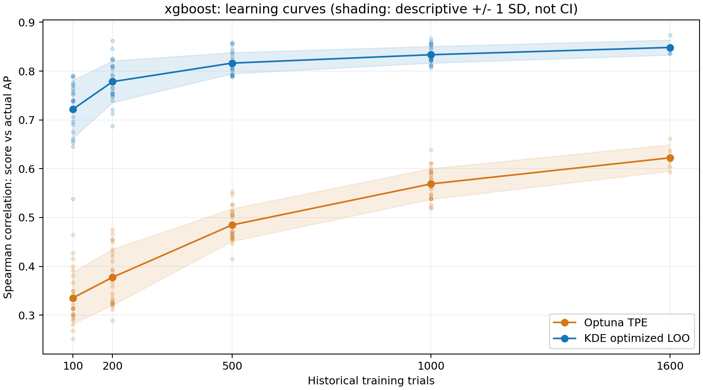
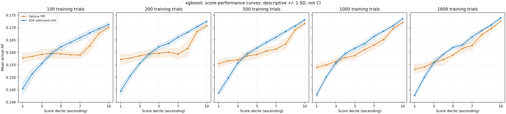
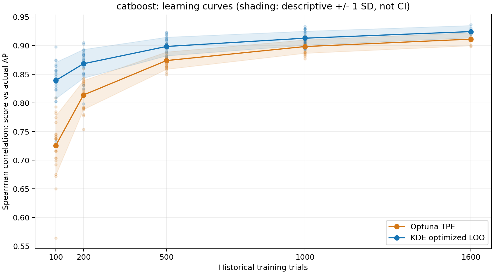
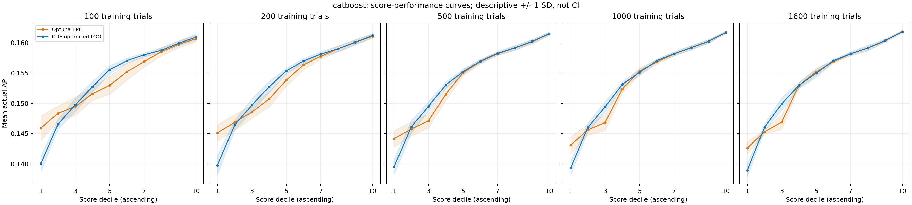

# Lighthouse: TPE und optimierte KDE nach Anzahl historischer Trials

Vollständig ausgeführt am **23. Oktober 2026**, auf beiden bisherigen Random-Studien.
**Die optimierte KDE erzielt bei sämtlichen untersuchten Trainingsgrößen die höhere
mittlere Spearman-Korrelation und die monotoneren Einzelkurven.** Der Vorsprung ist
bei XGBoost groß; bei CatBoost nähern sich beide Verfahren mit mehr Daten an.
Es gibt keinen untersuchten Trainingsgrößenbereich mit einem mittleren TPE-Vorteil.
Einzelne CatBoost-Paare fallen zugunsten von TPE aus.

Primäres Kriterium: **Je höher der Score, desto höher sollte im statistischen Mittel
die tatsächliche AP sein.** Top-k wird in diesem Experiment nicht ausgewertet.

## Gemeinsamer Versuchsaufbau

- Quelle: `../streamingmodel_NonRouterHHs/optuna.db`, über den bestehenden
  schreibgeschützten SQLite-Loader in eine temporäre Datenbank kopiert.
- Studien-ID 1: XGBoost, Datenkennung `4897daef3195`, 2.000 Trials, zehn Parameter.
- Studien-ID 6: CatBoost, Datenkennung `ccffacbaefb5`, phase1, 2.000 Trials, vier Parameter.
- Beide Studien maximieren `cv_average_precision_mean`; gespeichertes
  Studienattribut `sampler=random`. Je 2.000 unterschiedliche Konfigurationen,
  keine ausgeschlossenen Parameter oder bedingten/veränderten Distributionen.
- Dieselben bisherigen fünf Folds, Seed 42: jeweils 400 unveränderte Test-Trials
  und ein Pool von 1.600 Trainingstrials. Identische Konfigurationen würden zusammenbleiben.
- Pro Fold fünf zufällige Permutationen, erzeugt mit `SeedSequence([42, fold,
  repetition])`. Die Präfixe mit 100, 200, 500 und 1.000 Trials sind innerhalb
  einer Wiederholung geschachtelt. Auswahl ohne Verwendung von Objectives.
- Pro Trainingsstichprobe dieselben 20 % Good / 80 % Bad für beide Verfahren.
  Gruppenbildung ausschließlich aus Trainings-Objectives; Gleichstände werden
  wie bisher nach Trialnummer aufgelöst. Größen: 20/80, 40/160, 100/400,
  200/800 und 320/1.280.
- Bei 1.600 Trials nur eine vollständige Trainingsmenge pro Fold, ein Fit je
  Verfahren und keine künstliche Verfünffachung. 1.600 ist der bisherige Referenzumfang;
  ein Training auf allen 2.000 Beobachtungen würde keine unabhängige Testmenge lassen.

Das ergibt pro Studie **105 gemeinsame Trainingsstichproben, 210 Verfahrensauswertungen
und 84.000 Test-Scores**. Insgesamt wurden 420 Modelle aus je zwei Dichten geschätzt:
420 KDE-Dichtefits und 420 TPE-Dichtefits. Alle Testkonfigurationen sind innerhalb
eines Folds für beide Verfahren, alle Trainingsgrößen und Wiederholungen identisch.

**Verfahren unverändert:** TPE nutzt den vorhandenen `OptunaParzenAdapter` mit
`multivariate=True`, uniformen Gewichten, Prior-Gewicht 1, Magic Clip und ohne
Endpoint-Behandlung. Good/Bad werden direkt an die Dichteschätzer übergeben:
Optunas Standard-Gamma kommt nicht zum Einsatz. KDE nutzt die bisherigen
Parametertransformationen und Gauß-/Wang-Ryzin-Kernel mit der vorhandenen beschränkten
LOO-Optimierung. Keine neue Suche nach Startwerten, Grenzen oder Methodenparametern;
diskreter Start 0,5, kontinuierliche Grenzen [10⁻⁶, 10], diskrete Grenzen
[10⁻⁶, 1−10⁻⁶], L-BFGS-B mit unveränderten Abbruchkriterien und 120 Sekunden
Zeitlimit pro Dichte. Die datenabhängige Bandbreitenschätzung je Trainingsstichprobe
ist Bestandteil des bestehenden KDE-Verfahrens.

Beide Verfahren liefern `log p(x|Good) − log p(x|Bad)` für sämtliche Testkonfigurationen.
Es wurden keine neuen XGBoost-/CatBoost-Modelle trainiert und keine UI-Dateien geändert.

## Scoringqualität und Monotonie

ρ ist die Spearman-Korrelation zwischen Score und tatsächlicher AP innerhalb einer
Fold-/Wiederholungsauswertung. Angaben als Mittelwert ± deskriptive Stichproben-SD:
25 Auswertungen je Verfahren bei 100–1.000 Trials, fünf bei 1.600 Trials.
„Rückgänge“ zählt fallende benachbarte Dezilübergänge je Einzelkurve (von neun).
„Monoton“ ist der Anteil vollständig nicht fallender Einzelkurven.
ΔAP bezeichnet mittlere AP in D10 minus D1, als absolute AP-Differenz.
„Max. Rückgang“ ist das Mittel des jeweils größten Rückgangs einer Einzelkurve,
wobei vollständig monotone Kurven mit null eingehen.

### XGBoost

| Trials | Verfahren | Spearman ρ | Rückgänge | Monoton | Max. Rückgang, Ø | ΔAP D10–D1 | Fit-Erfolg |
| --- | --- | --- | --- | --- | --- | --- | --- |
| 100 | TPE | 0,335 ± 0,053 | 3,08 | 0 % | 0,003026 | 0,01231 | 25/25 |
| 100 | KDE | 0,722 ± 0,059 | 0,64 | 52 % | 0,000295 | 0,02582 | 25/25 |
| 200 | TPE | 0,378 ± 0,057 | 2,80 | 0 % | 0,003394 | 0,01353 | 25/25 |
| 200 | KDE | 0,778 ± 0,043 | 0,32 | 72 % | 0,000269 | 0,02798 | 25/25 |
| 500 | TPE | 0,485 ± 0,034 | 2,08 | 0 % | 0,001980 | 0,01609 | 25/25 |
| 500 | KDE | 0,816 ± 0,022 | 0,28 | 72 % | 0,000129 | 0,02928 | 25/25 |
| 1000 | TPE | 0,569 ± 0,032 | 1,80 | 4 % | 0,001231 | 0,01804 | 25/25 |
| 1000 | KDE | 0,834 ± 0,017 | 0,20 | 80 % | 0,000079 | 0,03056 | 25/25 |
| 1600 | TPE | 0,622 ± 0,027 | 1,60 | 20 % | 0,001106 | 0,01929 | 5/5 |
| 1600 | KDE | 0,848 ± 0,015 | 0,20 | 80 % | 0,000111 | 0,03110 | 5/5 |





[Alle einzelnen Fold-/Wiederholungskurven](xgboost/individual_deciles.png) · [Learning Curve als SVG](xgboost/learning_curve.svg) · [Dezilkurven als SVG](xgboost/score_performance.svg)

### CatBoost

| Trials | Verfahren | Spearman ρ | Rückgänge | Monoton | Max. Rückgang, Ø | ΔAP D10–D1 | Fit-Erfolg |
| --- | --- | --- | --- | --- | --- | --- | --- |
| 100 | TPE | 0,726 ± 0,052 | 1,00 | 32 % | 0,000838 | 0,01473 | 25/25 |
| 100 | KDE | 0,839 ± 0,032 | 0,24 | 76 % | 0,000060 | 0,02085 | 25/25 |
| 200 | TPE | 0,814 ± 0,025 | 0,48 | 52 % | 0,000552 | 0,01592 | 25/25 |
| 200 | KDE | 0,868 ± 0,025 | 0,08 | 92 % | 0,000035 | 0,02140 | 25/25 |
| 500 | TPE | 0,874 ± 0,015 | 0,56 | 48 % | 0,000423 | 0,01730 | 25/25 |
| 500 | KDE | 0,899 ± 0,016 | 0,04 | 96 % | 0,000023 | 0,02194 | 25/25 |
| 1000 | TPE | 0,898 ± 0,012 | 0,40 | 64 % | 0,000222 | 0,01857 | 25/25 |
| 1000 | KDE | 0,913 ± 0,012 | 0,00 | 100 % | 0,000000 | 0,02235 | 25/25 |
| 1600 | TPE | 0,911 ± 0,011 | 0,00 | 100 % | 0,000000 | 0,01921 | 5/5 |
| 1600 | KDE | 0,925 ± 0,011 | 0,00 | 100 % | 0,000000 | 0,02286 | 5/5 |





[Alle einzelnen Fold-/Wiederholungskurven](catboost/individual_deciles.png) · [Learning Curve als SVG](catboost/learning_curve.svg) · [Dezilkurven als SVG](catboost/score_performance.svg)

**Die Aggregation allein ist zu optimistisch:** Bei XGBoost ist die aggregierte
TPE-Dezilkurve ab 500 Trials monoton, obwohl bei 500 Trials keine der 25 Einzelkurven
vollständig monoton ist; bei 1.000 Trials sind es nur 1/25 und bei 1.600 nur 1/5.
KDE erreicht 18/25, 20/25 beziehungsweise 4/5. Bei 1.600 bleibt der bekannte
KDE-Rückgang in Fold 2 von D5 nach D6 um 0,000556 AP bestehen.

Bei CatBoost sind alle aggregierten Kurven beider Verfahren bereits bei 100 Trials
monoton. Die Einzelkurven unterscheiden sich dennoch deutlich: KDE erreicht bei
200 Trials 23/25 monotone Kurven, TPE erst 13/25. Bei 1.000 sind es 25/25 versus
16/25. Bei 1.600 sind beide Verfahren auf allen fünf Folds monoton.
Der Anteil monotoner TPE-Kurven steigt nicht durchgehend: bei CatBoost fällt er
von 52 % bei 200 auf 48 % bei 500 Trials, obwohl die AP-Rangkorrelation steigt.

Auch kleine Datenmengen können brauchbare mittlere Rangkorrelationen liefern,
aber instabile Einzelbewertungen: Bei XGBoost/KDE mit 100 Trials reicht ρ von
etwa 0,538 bis 0,790; nur 52 % der Einzelkurven sind monoton. Der größte beobachtete
Dezilrückgang beträgt 0,001781 AP. Für XGBoost/TPE beträgt der größte Rückgang
über alle Trainingsgrößen 0,007241 AP (bei 200 Trials). Numerische Stabilität
ist daher von der statistischen Zuverlässigkeit der Scores zu unterscheiden.

## Gepaarte Verfahrensunterschiede

Alle Differenzen sind **TPE minus KDE**, innerhalb derselben Studie, desselben Folds,
derselben Trainingsstichprobe und derselben 400 Testkonfigurationen. Negative Δρ
sprechen für KDE. Negative Differenzen der Rückgangszahl sprechen für TPE.
Die Spannweite zeigt beobachtete Einzelunterschiede, kein Konfidenzintervall.

| Studie | Trials | Δρ, Mittel ± SD | Δρ-Spannweite | TPE höheres ρ | Δ Rückgangszahl | Δ Dezilspreizung |
| --- | --- | --- | --- | --- | --- | --- |
| xgboost | 100 | -0,386 ± 0,076 | -0,504 bis -0,226 | 0/25 | 2,44 | -0,01351 |
| xgboost | 200 | -0,401 ± 0,063 | -0,537 bis -0,294 | 0/25 | 2,48 | -0,01446 |
| xgboost | 500 | -0,332 ± 0,033 | -0,400 bis -0,271 | 0/25 | 1,80 | -0,01319 |
| xgboost | 1000 | -0,265 ± 0,024 | -0,301 bis -0,211 | 0/25 | 1,60 | -0,01253 |
| xgboost | 1600 | -0,226 ± 0,019 | -0,243 bis -0,201 | 0/5 | 1,40 | -0,01181 |
| catboost | 100 | -0,114 ± 0,043 | -0,239 bis -0,044 | 0/25 | 0,76 | -0,00613 |
| catboost | 200 | -0,055 ± 0,021 | -0,098 bis 0,016 | 1/25 | 0,40 | -0,00548 |
| catboost | 500 | -0,025 ± 0,012 | -0,048 bis -0,002 | 0/25 | 0,52 | -0,00465 |
| catboost | 1000 | -0,015 ± 0,008 | -0,026 bis 0,003 | 1/25 | 0,40 | -0,00378 |
| catboost | 1600 | -0,013 ± 0,003 | -0,019 bis -0,011 | 0/5 | 0,00 | -0,00365 |

Bei XGBoost gewinnt KDE in allen 105 gepaarten AP-Rangkorrelationen. Bei CatBoost
gewinnt KDE in 103/105 Paaren; die zwei TPE-Vorteile bei 200 beziehungsweise
1.000 Trials bilden keinen konsistenten Vorteil einer Trainingsgröße.
Die vollständigen gepaarten Unterschiede einschließlich Monotonie, Rückgangsgrößen
und Laufzeit stehen in [paired_summary.csv](paired_summary.csv) und den Einzeldateien.

## Stabilität gegenüber der Trainingsstichprobe

Je Fold, Trainingsgröße und Verfahren werden die zehn Paare der fünf
Stichprobenwiederholungen verglichen. Die Tabellen mitteln über diese insgesamt
50 abhängigen Paarvergleiche. Rang-ρ misst die Übereinstimmung der Bewertung
identischer Testkonfigurationen; Dezilverschiebung ist der mittlere absolute
Unterschied ihrer Dezilnummer. Höheres Rang-ρ und kleinere Verschiebungen
bedeuten stabilere Bewertungen. Bei 1.600 gibt es keine unterschiedlichen
Trainingsstichproben und deshalb keinen solchen Stabilitätsschätzer.

| Studie | Trials | Rang-ρ TPE | Rang-ρ KDE | Dezilshift TPE | Dezilshift KDE | AP-ρ: Wiederholungs-SD TPE | AP-ρ: Wiederholungs-SD KDE |
| --- | --- | --- | --- | --- | --- | --- | --- |
| xgboost | 100 | 0,257 | 0,700 | 2,70 | 1,68 | 0,050 | 0,048 |
| xgboost | 200 | 0,342 | 0,805 | 2,51 | 1,33 | 0,053 | 0,028 |
| xgboost | 500 | 0,546 | 0,885 | 1,99 | 1,00 | 0,031 | 0,012 |
| xgboost | 1000 | 0,766 | 0,944 | 1,27 | 0,67 | 0,020 | 0,009 |
| catboost | 100 | 0,651 | 0,841 | 1,81 | 1,18 | 0,044 | 0,030 |
| catboost | 200 | 0,798 | 0,886 | 1,36 | 0,99 | 0,024 | 0,023 |
| catboost | 500 | 0,907 | 0,934 | 0,91 | 0,73 | 0,012 | 0,011 |
| catboost | 1000 | 0,960 | 0,964 | 0,55 | 0,51 | 0,005 | 0,008 |

Die Zuordnung einzelner Konfigurationen wird mit mehr Daten bei beiden Verfahren
stabiler; KDE ist nach Rangübereinstimmung und Dezilverschiebung bei jeder
untersuchten Größe im Mittel stabiler. Das bedeutet nicht, dass jede Streuungsmetrik
stets kleiner ist: Bei CatBoost/1.000 streut die AP-Korrelation zwischen den
Wiederholungen bei TPE etwas weniger als bei KDE, bei zugleich niedrigerem
mittleren AP-ρ und weniger monotonen Kurven.

Die mittlere SD der Wiederholungen innerhalb eines Folds steht in den letzten
beiden Spalten. Die SD der fünf Fold-Mittelwerte wird separat als
`sd_fold_mean_spearman` in den jeweiligen `summary.csv` gespeichert. Sie misst
Variation zwischen den konkreten Folds und ist ebenfalls deskriptiv.
Alle nach Fold und Wiederholung gepaarten Stabilitätsdifferenzen stehen in
[stability_paired.csv](stability_paired.csv). Absolute Scores werden wegen
verfahrens- und fitabhängiger Skalen nicht über Fits gepoolt.

## Rechenzeit und technische Robustheit

Mittlere Wandzeit in Millisekunden für einen Fit beider Dichten und die Bewertung
aller 400 Testkonfigurationen. Beide Verfahren laufen seriell im selben Prozess
mit je einem BLAS-/OpenMP-Thread; ohne Datenladen, einmalige Parameterkodierung,
Dateiausgabe und Plot-Erzeugung. Die Fitzeit umfasst beim KDE auch Distanzcache
und Initialisierung. Alle Versuche einschließlich möglicher Ausfälle würden in
diese Zeitmittel eingehen. Die Messungen sind keine wiederholten Hardwarebenchmarks.

| Studie | Trials | Fit TPE, ms | Fit KDE, ms | 400 Scores TPE, ms | 400 Scores KDE, ms |
| --- | --- | --- | --- | --- | --- |
| xgboost | 100 | 0,27 | 17,41 | 19,66 | 2,10 |
| xgboost | 200 | 0,26 | 25,73 | 34,77 | 2,88 |
| xgboost | 500 | 0,27 | 118,83 | 84,36 | 5,25 |
| xgboost | 1000 | 0,30 | 523,28 | 179,43 | 9,85 |
| xgboost | 1600 | 0,33 | 1524,73 | 292,89 | 16,14 |
| catboost | 100 | 0,17 | 4,71 | 11,88 | 1,39 |
| catboost | 200 | 0,16 | 8,86 | 20,83 | 1,83 |
| catboost | 500 | 0,17 | 44,06 | 52,96 | 3,22 |
| catboost | 1000 | 0,19 | 182,74 | 102,40 | 5,50 |
| catboost | 1600 | 0,21 | 484,44 | 164,91 | 8,23 |

TPE fittet erheblich schneller; KDE bewertet die Testpunkte erheblich schneller.
Für einen Fit mit anschließend 400 Scores liegt KDE hier bei XGBoost bis 200 Trials
etwa gleichauf oder vorn, ab 500 liegt TPE vorn. Bei CatBoost ist KDE bis 500 Trials
insgesamt schneller, ab 1.000 TPE. Bei 1.600 dauern Fit plus 400 Scores etwa
0,293 s versus 1,541 s für XGBoost und 0,165 s versus 0,493 s für CatBoost
(jeweils TPE versus KDE). Eine pauschale Aussage zum schnelleren Verfahren wäre
vom Verhältnis zwischen erneutem Fitten und der Zahl späterer Scoreabfragen abhängig.

Alle 420 Verfahrensauswertungen liefern vollständige endliche Scores. Alle
420 KDE-Dichtefits konvergieren und erfüllen den bisherigen zusätzlichen
Optimierungsfortschrittsnachweis. Keine Timeouts, Optimierungsabbrüche,
verfahrensbezogenen Warnungen während Fit/Scoring oder Ersatzbandbreiten.
Optuna weist beim Erzeugen des unveränderten Adapters auf die experimentelle
multivariate Schnittstelle hin. Aus den null beobachteten Ausfällen lässt sich
kein Unterschied der allgemeinen Fehleranfälligkeit ableiten.

XGBoost trifft keine Bandbreitengrenzen, auch nicht mit nur 20 Good-Beobachtungen
für zehn Parameter. Bei CatBoost trifft jeweils `depth` in der Bad-Gruppe die
untere Grenze: 0/50 Dichtefits bei 100, 0/50 bei 200, 1/50 bei 500, 6/50 bei
1.000 und 5/10 bei 1.600 Trials. Kein oberer Grenztreffer. Das ist eine dokumentierte
Randlösung des unveränderten Verfahrens, kein Optimierungsfehler.
Ein methodenspezifischer Spitzen-Speicherbedarf wurde nicht gemessen;
entsprechende Vergleiche werden nicht behauptet.

## Einordnung der benötigten Datenmenge

1. **Zuverlässigerer Performance-Score:** KDE liegt in beiden Studien bei allen
   Trainingsgrößen im Mittel vorn. Bei XGBoost übertrifft bereits KDE mit 100 Trials
   das mittlere AP-ρ von TPE mit 1.600 Trials (0,722 versus 0,622), allerdings noch
   mit deutlicher Stichprobenabhängigkeit. Bei CatBoost ist der Abstand kleiner.
2. **Bereiche relativer Überlegenheit:** Kein mittlerer TPE-Vorteil im untersuchten
   Raster. Der KDE-Vorsprung schrumpft bei XGBoost von rund 0,387 bei 100 auf 0,226
   bei 1.600 Trials und bei CatBoost von 0,114 auf 0,013. Die zwei einzelnen
   CatBoost-TPE-Vorteile reichen nicht für eine allgemeine Überlegenheitsaussage.
3. **Geschwindigkeit der Verbesserung:** Von 100 auf 1.600 steigt das mittlere ρ
   bei XGBoost um 0,287 (TPE) beziehungsweise 0,127 (KDE), bei CatBoost um 0,186
   beziehungsweise 0,085. Der größere absolute TPE-Zuwachs geht vom niedrigeren
   Ausgangsniveau aus. KDE gewinnt von 100 auf 200 bereits 0,057 bei XGBoost und
   0,029 bei CatBoost; von 1.000 auf 1.600 noch 0,015 beziehungsweise 0,012.
   Mehr Daten helfen weiter, mit sinkendem zusätzlichem Ertrag pro Trial.
4. **Weniger Trials für stabile Beziehungen:** KDE benötigt in diesen Studien
   weniger Daten für vergleichbare globale Rangkorrelationen und monotone Kurven.
   Bei CatBoost erreicht KDE mit 200 Trials ρ=0,868 und 92 % monotone Kurven;
   TPE mit 500 erreicht zwar ρ=0,874, aber nur 48 % monotone Kurven. Bei KDE/1.000
   sind alle 25 CatBoost-Kurven monoton; TPE erreicht dies erst beim untersuchten
   Referenzumfang 1.600, dort mit nur fünf Kurven. Bei XGBoost erscheinen 500–1.000
   KDE-Trials deutlich belastbarer als 100–200, garantieren aber keine vollständig
   monotonen Einzelkurven. TPE bleibt dort bis 1.600 hinter KDE zurück.
5. **Keine universelle Mindestzahl:** Die Daten stützen abgestufte Empfehlungen
   für genau diese Studien, keine feste Freigabegrenze für Lighthouse. Bei 1.600
   kann die Wiederholungsstabilität wegen identischer vollständiger Trainingsmengen
   nicht separat geschätzt werden. Ob zusätzliche unabhängige historische Trials
   das Verhalten weiter verbessern, wurde nicht untersucht. Modellfamilie,
   Datenrepräsentation und Suchraum unterscheiden sich gleichzeitig; der Versuch
   isoliert nicht den kausalen Einfluss der Parameterzahl.

## Abhängigkeiten und Grenzen der Interpretation

Die Folds teilen sich Trainingsbeobachtungen; Wiederholungen teilen Testdaten und
überlappen im Training; Trainingsgrößen sind geschachtelt. Die 25 Einzelwerte und
auch die 50 Stabilitätspaare sind deshalb keine unabhängigen Replikate. Die
angegebenen SDs, Spannweiten und Streuungsbänder beschreiben den Versuch und sind
**keine Konfidenzintervalle**. Es werden keine naiven Standardfehler, p-Werte oder
Signifikanzbehauptungen verwendet. Auch 105 gewonnene Paarvergleiche sind keine
105 unabhängigen Belege.

Die Methoden werden auf identischen Testkonfigurationen verglichen. Dezile werden
jedoch getrennt nach der jeweiligen Score-Rangfolge gebildet und können deshalb
unterschiedliche Konfigurationen enthalten; gepaart werden die resultierenden
Kennzahlen derselben Auswertung. Test-Objectives beeinflussen weder Auswahl noch
Fit, sondern erst die Auswertung. Alle Auswertungen sind vollständig erfolgreich;
es entsteht hier keine Verzerrung durch selektiven Ausschluss fehlgeschlagener Fits.

## Artefakte und Reproduktion

Der neue Modus in [benchmark_tpe_kde.py](../../../../examples/api/benchmark_tpe_kde.py)
verändert den bestehenden normalen Benchmark und den Robustheitsmodus nicht.
Ausführung vom Repository-Verzeichnis, jeweils mit den vollständigen Studiennamen
in `execution.json` beziehungsweise den Metadaten:

```bash
UV_CACHE_DIR=/tmp/deepcave-uv-cache MPLCONFIGDIR=/tmp/deepcave-matplotlib \
OMP_NUM_THREADS=1 OPENBLAS_NUM_THREADS=1 MKL_NUM_THREADS=1 \
uv run --locked python examples/api/benchmark_tpe_kde.py \
  --source ../streamingmodel_NonRouterHHs/optuna.db \
  --study-name '<study_name aus execution.json>' \
  --output docs/validation/tpe_kde/learning_curves/<xgboost oder catboost> \
  --learning-curve \
  --reference-oof docs/validation/tpe_kde/robustness/<xgboost oder catboost>/start_0.5/oof_scores.csv

UV_CACHE_DIR=/tmp/deepcave-uv-cache OPENBLAS_NUM_THREADS=1 \
uv run --locked python examples/api/verify_tpe_kde_learning_curves.py

UV_CACHE_DIR=/tmp/deepcave-uv-cache MPLCONFIGDIR=/tmp/deepcave-matplotlib \
OMP_NUM_THREADS=1 OPENBLAS_NUM_THREADS=1 MKL_NUM_THREADS=1 \
uv run --locked pytest tests/test_tpe_kde_benchmark.py --no-cov -q
```

Versionen unverändert zur historischen Referenz: Optuna 3.6.1, statsmodels 0.14.6,
NumPy 2.2.6, SciPy 1.15.3, matplotlib 3.9.0; Python 3.10. Die beiden vollständigen
Durchläufe dauerten einschließlich Scores, Ergebnisdateien und Plots rund
38,3 s und 17,3 s, ohne Datenbankladen. Das ist keine reine Fitzeit.

Pro Studie liegen folgende Dateien vor:

- `trials.csv`, `samples.json`, `metadata.json`: sämtliche Trial- und Fold-IDs,
  Objectives, Konfigurationen, Seeds, Good/Bad-Gruppen, Konfigurationen der Verfahren,
  Distributionen, Transformationen, Versionen und Daten-/Skript-Hashes.
- `oof_scores.csv`: alle 42.000 gepaarten Testbewertungen, je zwei Scores,
  Trialnummer, Fold, Trainingsgröße, Wiederholung und Gültigkeitsstatus.
- `fit_metrics.csv`, `summary.csv`, `paired_metrics.csv`: vollständige Einzelmetriken,
  getrennte Streuungsmaße, Fitstatus, Laufzeiten und gepaarte Differenzen.
- `deciles.csv`, `stability_pairs.csv`, `diagnostics.json`: alle Dezilmittelwerte,
  Ranking-/Dezilstabilität und sämtliche Good-/Bad-Optimierungsdiagnosen.
- `reference_checks.json`: vollständiger Vergleich mit den historischen
  TPE- und KDE-Scores bei 1.600 Trials. Maximale absolute Abweichung **0** für
  beide Verfahren auf beiden Studien; sämtliche Fold-/Trial-/Objective-/Parameter-
  Zuordnungen stimmen überein.
- Gemeinsame Dateien: [paired_summary.csv](paired_summary.csv),
  [decile_summary.csv](decile_summary.csv), [stability_paired.csv](stability_paired.csv),
  [execution.json](execution.json) und [verification.json](verification.json).

Der unabhängige gespeicherte Ergebnischeck prüft pro Studie alle 105 Trainingsstichproben,
210 AP-Rangkorrelationen, 2.100 Dezilmittelwerte, 105 gepaarten Kennzahlvergleiche
und 400 Stabilitätspaare. Sämtliche nachgerechneten Rangkorrelationen und Dezilmittelwerte
stimmen exakt überein. **27 gezielte Tests bestanden**, einschließlich identischer
Trainingsgruppen für beide Verfahren, geschachtelter Stichproben, einmaligem
Volltraining, Reproduktion der Referenzscores und expliziter Fehlerbehandlung.
