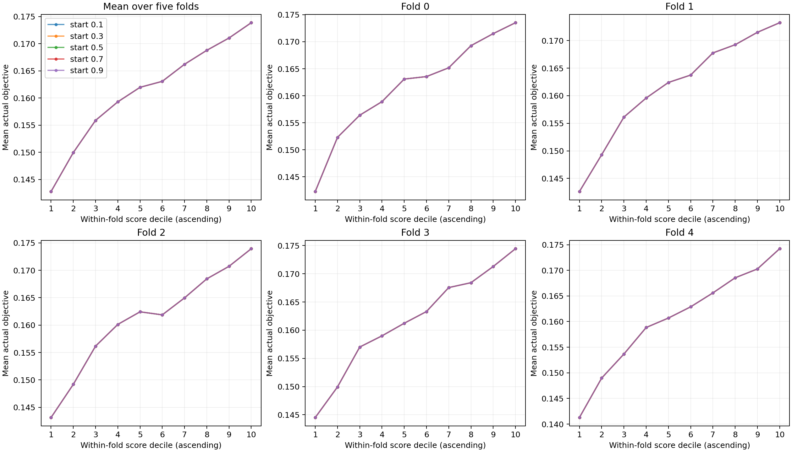
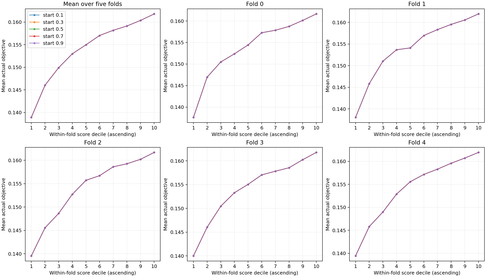

# Robustheit der KDE-Bandbreitenoptimierung

Vollständig ausgeführt am **23. Oktober 2026**: zwei vorhandene Random-Studien,
je fünf Startwerte × fünf Folds × zwei Dichten = **100 eigenständige Fits**.

**Ergebnis:** In beiden Studien konvergieren alle Startwerte zu numerisch
vergleichbaren Lösungen und praktisch identischen Konfigurationsrankings.
Die mittlere Spearman-Korrelation mit AP bleibt bei **0,84841 (XGBoost)** bzw.
**0,92457 (CatBoost)**. Das unterstützt die Nutzung für ausreichend große,
feste Suchräume. Eine uneingeschränkte Freigabe für beliebige Optuna-Studien
wäre daraus nicht begründet: Kategorien sind empirisch noch unvalidiert,
bedingte Suchräume werden abgewiesen, und CatBoost zeigt echte Randlösungen.

## Daten und unveränderter Versuchsaufbau

Quelle: `../streamingmodel_NonRouterHHs/optuna.db`, schreibgeschützt geöffnet
und vor dem Laden durch Optuna in eine temporäre Datenbank kopiert.

| Eigenschaft | XGBoost | CatBoost |
|---|---|---|
| Datenbank-Studien-ID | 1 | 6 |
| Datenkennung | `4897daef3195` | `ccffacbaefb5`, phase1 |
| Endliche abgeschlossene Trials | 2.000 | 2.000 |
| Unterschiedliche Konfigurationen | 2.000 | 2.000 |
| Deklariertes Studienattribut `sampler` | `random` | `random` |
| Objective | `cv_average_precision_mean`, maximieren | dasselbe |
| Nichtkonstante Parameter | 10: 7 kontinuierlich, 3 geordnet diskret | 4: 2 kontinuierlich, 2 geordnet diskret |
| Bedingte/veränderte Distributionen | keine | keine |
| Entfernte Parameter/Teilraumreduktion | keine | keine |

Die Samplingstrategie ist durch gespeicherte Studienattribute belegt, nicht
durch den beim Laden eingesetzten Optuna-Standardsampler. Es gibt keinen
zusätzlichen Samplernachweis für jeden einzelnen Trial. Modellfamilie und
Datenrepräsentation unterscheiden sich zugleich; der Versuch isoliert daher
nicht den kausalen Einfluss der Parameteranzahl.

Alle Parameter sind in sämtlichen Trials aktiv, ihre Distributionen unverändert.
Der CatBoost-Suchraum ist:

| Parameter | Deklarierter Bereich | KDE-Darstellung |
|---|---|---|
| `depth` | Integer 5–9, Schritt 1 | geordneter Gitterindex 0–4 |
| `iterations` | Integer 300–1.500, Schritt 100 | geordneter Gitterindex 0–12 |
| `l2_leaf_reg` | Float 1–20, logarithmisch | log-transformiert auf [0,1] |
| `learning_rate` | Float 0,005–0,08, logarithmisch | log-transformiert auf [0,1] |

Der vollständige XGBoost-Suchraum steht im [vorherigen Bericht](../README.md).
Distributionen beider Studien stehen zusätzlich in den Metadaten jeder Variante.

Seed 42, fünf Folds mit je **400 Test- und 1.600 Trainingstrials**.
Good/Bad werden ausschließlich aus den Trainings-Objectives gebildet: 320/1.280.
Identische Konfigurationen bleiben zusammen. Innerhalb einer Studie sind Trials,
Testkonfigurationen, Folds und Trainingsgruppen für alle Starts identisch.
Für XGBoost wurden sie zusätzlich gegen die historischen OOF-Daten geprüft.
Der Start 0,5 reproduziert die bisherigen optimierten Scores **exakt**
(maximale absolute Differenz 0).

Nur die diskreten Startwerte werden gemeinsam auf 0,1 / 0,3 / 0,5 / 0,7 / 0,9
gesetzt. Kontinuierliche Starts bleiben die bisherige Normalreferenzregel mit
derselben Beschränkung auf [10⁻⁵, 1]. Unverändert bleiben Gauß-, Wang-Ryzin- und
Aitchison-Aitken-Kernel, die exakte mittlere negative LOO-Log-Likelihood,
analytischer Gradient, L-BFGS-B, `maxiter=200`, `ftol=1e-10`, `gtol=1e-5`,
`maxls=40`, Zeitlimit 120 Sekunden pro Dichte und sämtliche Optimierungsgrenzen.
Es gibt keine Auswahl der besten Initialisierung und keinen neuen Fallback.

## Übersicht aller Initialisierungen

LOO bedeutet hier **mittlere Log-Likelihood pro Beobachtung**, getrennt nach
Good und Bad; die Tabelle mittelt jeweils über dieselben fünf Trainingsgruppen.
Diese Mittelwerte sind eine kompakte Beschreibung. Bewertet werden zusätzlich
die **gepaarten Differenzen innerhalb desselben Folds und derselben Gruppe**.
Ein Vergleich von Good mit Bad oder der absoluten LOO-Werte zwischen Studien
ist nicht sinnvoll. Summierte und mittlere LOO-Werte für jeden einzelnen Fit
stehen in den verlinkten CSV-/JSON-Dateien.

Ranking-Stabilität bezeichnet das Minimum der 20 paarweisen Korrelationen
eines Startwerts mit den vier anderen Starts über fünf Folds.
Spearman mit AP ist Mittelwert ± Stichproben-SD der fünf Fold-Korrelationen;
absolute Scores verschiedener Folds werden nicht gepoolt.

### XGBoost

| Startwert | LOO Good / Bad | Spearman mit AP | Score-Ranking-Stabilität, min. ρ | Konvergenz |
|---|---:|---:|---:|---:|
| 0,1 | −9,456580 / −10,233036 | 0,848409 ± 0,015368 | 0,9999998125 | 10/10 |
| 0,3 | −9,456580 / −10,233036 | 0,848409 ± 0,015368 | 0,9999998125 | 10/10 |
| 0,5 | −9,456580 / −10,233036 | 0,848413 ± 0,015365 | 0,9999998125 | 10/10 |
| 0,7 | −9,456580 / −10,233036 | 0,848409 ± 0,015368 | 0,9999998125 | 10/10 |
| 0,9 | −9,456580 / −10,233036 | 0,848409 ± 0,015368 | 0,9999998125 | 10/10 |

Größter Abstand zur besten beobachteten LOO-Lösung **derselben Trainingsgruppe**:
**1,54 × 10⁻⁹** pro Beobachtung. Die mittlere AP-Korrelation variiert zwischen
den Starts um nur **3,38 × 10⁻⁶**. Alle 50 Fits sind mit Status 0 konvergiert
und erfüllen zusätzlich den bisherigen Fortschrittsnachweis. Kein Grenztreffer.

[Übersicht als CSV](xgboost/summary.csv) · [alle 50 gepaarten LOO-Ergebnisse](xgboost/paired_loo.csv) ·
[alle 50 Rankingvergleiche](xgboost/ranking_pairs.csv) · [2.000 OOF-Scores pro Variante](xgboost/oof_scores.csv)

### CatBoost

| Startwert | LOO Good / Bad | Spearman mit AP | Score-Ranking-Stabilität, min. ρ | Konvergenz |
|---|---:|---:|---:|---:|
| 0,1 | −3,420282 / −4,443548 | 0,924570 ± 0,010669 | 0,9999998125 | 10/10 |
| 0,3 | −3,420282 / −4,443548 | 0,924568 ± 0,010672 | 0,9999998125 | 10/10 |
| 0,5 | −3,420282 / −4,443548 | 0,924570 ± 0,010669 | 0,9999998125 | 10/10 |
| 0,7 | −3,420282 / −4,443548 | 0,924564 ± 0,010669 | 0,9999998125 | 10/10 |
| 0,9 | −3,420282 / −4,443548 | 0,924568 ± 0,010672 | 0,9999998125 | 10/10 |

Größter gepaarter LOO-Abstand: **1,75 × 10⁻¹⁰** pro Beobachtung;
Spannweite der mittleren AP-Korrelation: **5,71 × 10⁻⁶**.
Alle 50 Fits konvergieren mit Status 0 und bestehen den Fortschrittsnachweis.
Bei **allen 25 Bad-Fits** liegt `depth` auf der Untergrenze 10⁻⁶.
Die 25 Good-Fits liegen vollständig im Inneren. Kein oberer Grenztreffer.

[Übersicht als CSV](catboost/summary.csv) · [alle 50 gepaarten LOO-Ergebnisse](catboost/paired_loo.csv) ·
[alle 50 Rankingvergleiche](catboost/ranking_pairs.csv) · [2.000 OOF-Scores pro Variante](catboost/oof_scores.csv)

### Iterationen und Laufzeiten

| Startwert | XGBoost: Iterationen je Fit | XGBoost: Fitzeit gesamt | CatBoost: Iterationen je Fit | CatBoost: Fitzeit gesamt |
|---|---:|---:|---:|---:|
| 0,1 | 22–34 | 10,175 s | 9–12 | 2,441 s |
| 0,3 | 19–32 | 9,247 s | 10–12 | 2,753 s |
| 0,5 | 17–28 | 8,183 s | 9–13 | 2,547 s |
| 0,7 | 17–28 | 8,051 s | 10–15 | 3,127 s |
| 0,9 | 21–33 | 9,726 s | 11–19 | 3,765 s |

Wandzeiten mit je einem BLAS-/OpenMP-Thread, einschließlich Distanzcache,
ohne Laden, Scores und Plots. Ein Durchlauf je Variante, keine wiederholte
Laufzeitmessung: Die Zeiten erlauben keine verlässliche Wahl eines schnellsten
Starts. Kein Timeout, keine nichtendliche Likelihood, kein nichtendlicher Score
und kein Optimierungsabbruch. Funktionsauswertungen, Laufzeit, Status und
Abbruchtext jedes Fits stehen in `paired_loo.csv` und in den ursprünglichen
`start_*/optimization_diagnostics.json`.

## Bandbreiten und praktische Score-Stabilität

Die Bandbreiten unterscheiden sich bei identischen Trainingsdaten höchstens
um **1,80 × 10⁻⁵ (XGBoost)** bzw. **8,43 × 10⁻⁶ (CatBoost)** zwischen zwei Starts.
Das sind kleine numerische Restabweichungen bei vergleichbaren LOO-Werten;
es gibt hier keinen Hinweis auf praktisch unterschiedliche lokale Optima.
Ein Beweis globaler Optimalität folgt daraus nicht.

| Studie / Parameter | Finaler Bereich über alle Folds, Gruppen und Starts | Größte Spannweite zwischen Starts bei festem Fold/Gruppe |
|---|---:|---:|
| XGBoost `colsample_bytree` | 0,184210–0,257602 | 1,33 × 10⁻⁵ |
| XGBoost `gamma` | 0,153344–0,262634 | 1,45 × 10⁻⁵ |
| XGBoost `learning_rate` | 0,084653–0,178164 | 1,14 × 10⁻⁵ |
| XGBoost `max_delta_step` | 0,577568–0,664570 | 1,80 × 10⁻⁵ |
| XGBoost `max_depth` | 0,472249–0,511484 | 1,22 × 10⁻⁵ |
| XGBoost `min_child_weight` | 0,156685–0,203178 | 8,97 × 10⁻⁶ |
| XGBoost `n_estimators` | 0,824603–0,837517 | 5,88 × 10⁻⁶ |
| XGBoost `reg_alpha` | 0,183340–0,253028 | 1,21 × 10⁻⁵ |
| XGBoost `reg_lambda` | 0,137776–0,236169 | 9,90 × 10⁻⁶ |
| XGBoost `subsample` | 0,193922–0,255750 | 1,40 × 10⁻⁵ |
| CatBoost `depth` | 0,000001–0,134051 | 6,44 × 10⁻⁶ |
| CatBoost `iterations` | 0,398555–0,468688 | 8,43 × 10⁻⁶ |
| CatBoost `l2_leaf_reg` | 0,100234–0,158660 | 2,99 × 10⁻⁶ |
| CatBoost `learning_rate` | 0,047981–0,089138 | 4,91 × 10⁻⁶ |

Die breiten Bereiche in der mittleren Spalte entstehen vor allem durch andere
Trainingsgruppen, nicht durch die Initialisierung. Alle einzelnen initialen
und finalen Bandbreiten: [XGBoost](xgboost/bandwidths.csv), [CatBoost](catboost/bandwidths.csv).

Die maximale absolute Änderung eines Test-Scores zwischen zwei Starts beträgt
**0,001306 bei XGBoost**, **0,000421 bei CatBoost**. Die Rangkorrelation liegt
in jedem der jeweils 50 Paarvergleiche bei mindestens **0,9999998125**.
Die minimale Rangkorrelation ist in beiden Studien zufällig gleich; sämtliche
einzelnen Werte stehen in `ranking_pairs.csv`. Die wenigen Rangänderungen
verändern keine Dezilzugehörigkeit: **alle fünf Varianten erzeugen innerhalb
einer Studie exakt dieselben 50 Fold-Dezilmittelwerte**.

## Score und tatsächliche Performance

Aufsteigende Score-Ränge werden **innerhalb jedes Test-Folds** in zehn Gruppen
mit je 40 Konfigurationen geteilt. Die aggregierte Kurve mittelt die fünf
Fold-Mittelwerte eines Dezils. Top-k wird nicht als Entscheidungskriterium benutzt.

| Score-Dezil | Mittlere AP, XGBoost | Mittlere AP, CatBoost |
|---|---:|---:|
| 1 | 0,142770 | 0,138931 |
| 2 | 0,149945 | 0,146031 |
| 3 | 0,155874 | 0,149909 |
| 4 | 0,159292 | 0,152979 |
| 5 | 0,161967 | 0,154964 |
| 6 | 0,163069 | 0,157027 |
| 7 | 0,166210 | 0,158175 |
| 8 | 0,168782 | 0,159126 |
| 9 | 0,171054 | 0,160363 |
| 10 | 0,173869 | 0,161794 |

Diese Tabelle gilt **für jeden der fünf Startwerte**.

| Studie | Fallende Übergänge aggregiert, je Start | Fallende Übergänge in Fold-ID 0/1/2/3/4, je Start | Insgesamt innerhalb der Folds |
|---|---:|---|---:|
| XGBoost | 0/9 | 0 / 0 / 1 / 0 / 0 | 1/45 |
| CatBoost | 0/9 | 0 / 0 / 0 / 0 / 0 | 0/45 |

Die einzige Abnahme bei XGBoost bleibt Fold 2, Dezil 5 → 6, um 0,000556 AP.
Kleinster aggregierter AP-Zuwachs: +0,001102 (XGBoost), +0,000951 (CatBoost).
Das gewünschte Kriterium „höherer Score, im Mittel höherer Objective-Wert“ bleibt
damit für alle Starts stabil, auch bei Betrachtung der einzelnen Folds.
Die überlappenden CV-Trainingsmengen sind keine fünf unabhängigen Studien;
die berichtete SD ist eine deskriptive Fold-Streuung, kein Konfidenzintervall.





Die fünf Linien überlagern sich wegen identischer Dezilwerte.
Vektorgrafiken: [XGBoost](xgboost/robustness_deciles.svg), [CatBoost](catboost/robustness_deciles.svg).
Alle Fold-Dezile: [XGBoost](xgboost/decile_metrics.csv), [CatBoost](catboost/decile_metrics.csv).

## Mathematische und heuristische Grenzen

Die folgenden Aussagen folgen aus den tatsächlich verwendeten Formeln in
`loo_objective`, `kde_logpdf` und den installierten statsmodels-0.14.6-Kerneln
(`statsmodels/nonparametric/kernels.py`). Die Optimierungsgrenzen wurden
**weder für diese Untersuchung noch zwischen den Studien verändert**.

### Kontinuierlich: [10⁻⁶, 10]

Der Gauß-Kernel erfordert mathematisch **h > 0**, aber keine endliche obere
Grenze. 10⁻⁶ ist eine numerische/regularisierende Untergrenze, keine
mathematische Konstante. Sie kann bei sehr konzentrierten oder wiederholten
Werten eine unbeschränkte LOO-Lösung begrenzen; Normierung verhindert solche
Datensituationen nicht.

Die obere Grenze 10 ist zunächst heuristisch gewählt, für die vorhandene
Transformation auf [0,1] aber nachweislich großzügig: Für eine kontinuierliche
Koordinate ist die Ableitung der negativen mittleren LOO-Log-Likelihood nach
log h gleich **1 − E_w[(xᵢ−xⱼ)²]/h²**. Alle quadrierten Abstände sind höchstens
1. Bei h > 1 ist diese Ableitung deshalb positiv, unabhängig von den anderen
Kerneltypen und ihrer Anzahl. Eine Verkleinerung von h verbessert dann die
Likelihood. Ein Optimum dieser normierten Daten braucht folglich kein h > 1.
Die Grenze 10 schränkt solche Lösungen nicht ein.

Das Argument gilt für die hier verwendete Kodierung deklarierter, endlicher
Grenzen. Die Funktion `fit_kde` allein erzwingt keine Normierung beliebiger
extern übergebener Arrays. Ursprüngliche Maßeinheiten verschwinden durch die
Transformation; Parameteranzahl, Datendichte und effektive Dimension bleiben
für Statistik, Speicherbedarf und lokale Optimierung relevant.

### Geordnet diskret: [10⁻⁶, 0,999999]

Wang-Ryzin verwendet bei gleichem Gitterwert `1−λ`, sonst
`(1−λ) λ^|Δ| / 2`. Der nichtdegenerierte Bereich ist **0 ≤ λ < 1**;
λ=0 ist als Punktmasse mathematisch möglich, λ=1 lässt die endlichen
Kernelwerte verschwinden. Die offenen numerischen Abstände 10⁻⁶ zu beiden
Endpunkten vermeiden `log(0)` und singuläre Gradienten der verwendeten
Parametrisierung. Die Größen dieser Abstände sind heuristisch.

Die Bandbreite ist ein dimensionsloser Zerfallsparameter auf dem **Gitterindex**,
keine Standardabweichung in ursprünglichen Integer-Einheiten. Andere Schrittweiten
werden durch die Kodierung berücksichtigt; eine andere Anzahl von Gitterwerten
kann andere optimale λ erzeugen. Eine universelle Eignung derselben Epsilon-Werte
für extrem feine oder dünn besetzte Gitter ist damit nicht nachgewiesen.
Log-Integer werden bereits jetzt kontinuierlich relaxiert und verwenden diese
diskreten Grenzen nicht; das ist eine dokumentierte Einschränkung der bestehenden
Implementierung.

### Ungeordnet kategorial: [10⁻⁶, 0,999999]

Aitchison-Aitken verwendet `1−λ` bei gleicher Kategorie und `λ/(C−1)` sonst.
Für C ≥ 2 sind **0 ≤ λ ≤ 1** nichtnegative, normierte Kategoriegewichte.
Die numerischen Epsilon-Abstände sind wieder keine mathematische Vorgabe.
Bei λ=(C−1)/C sind alle Kategorien gleich gewichtet. Oberhalb davon bekommt
eine andere Kategorie mehr Gewicht als die Ursprungskategorie: weiterhin
gültige Wahrscheinlichkeiten, aber keine zunehmend geglättete Ähnlichkeit
im üblichen Sinn. Die Grenze 0,999999 erzwingt diese übliche Glättungseigenschaft
nicht; ihr sinnvoller Bereich hängt insoweit von der Kategorienzahl ab.
Das wurde hier analysiert, aber mangels geeigneter Kategoriestudie nicht
empirisch getestet oder geändert.

### Gemessene Randlösung bei CatBoost

In allen Bad-Gruppen wird `depth` auf λ=10⁻⁶ optimiert. Die Ableitung der
negativen mittleren LOO-Likelihood in Richtung größerer λ ist beim Start 0,5
**+0,0354 bis +0,0600**. Die untere Schranke ist somit tatsächlich aktiv;
der unprojizierte Gradient muss an einer Randlösung nicht null sein.
Der für L-BFGS-B relevante projizierte Gradient liegt in diesen fünf Fits
zwischen **5,43 × 10⁻⁷ und 6,26 × 10⁻⁶**, innerhalb `gtol=1e-5`.

Zusätzlich wurden bei festgehaltenen anderen Bandbreiten die Likelihoods für
λ=10⁻⁶, 10⁻⁵, 10⁻⁴, 10⁻³ und 0,01 ausgewertet: Jede Vergrößerung verschlechtert
die Likelihood. Eine reine Grenzwertauswertung mit dem nativen Kernel bei λ=0
(**keine Neuoptimierung, keine Änderung der Optimierungsgrenzen**) verbessert
die mittlere LOO-Log-Likelihood nur um **3,54 × 10⁻⁸ bis 6,00 × 10⁻⁸**.
Die maximale Scoreänderung beträgt dabei **8,73 × 10⁻⁵**, die Rangfolge bleibt
in jedem Fold unverändert (Spearman 1). Die Schranke begrenzt hier also den
optimalen Grenzfall, ohne die praktische Bewertung erkennbar zu beeinträchtigen.
Diese Aussage betrifft diese Daten und die anderen festgehaltenen Bandbreiten,
keine allgemeine Fehlergrenze für beliebige Studien.

[Alle Grenzwertauswertungen und Gradienten](boundary_diagnostics.json).

## Eignung der zweiten Studie und offene Generalisierung

Die [Datenbankinventur](study_inventory.json) erfasst alle 31 vorhandenen Studien,
Samplingattribute, Trialzustände und Distributionen abgeschlossener Trials.
CatBoost-ID 6 wurde wegen anderer Modellfamilie, vier statt zehn Parametern,
anderer Bereiche und gleicher Stichprobengröße ausgewählt, vor Auswertung
der KDE-Ergebnisse. Andere CatBoost-Random-Studien sind vorhanden, aber weniger
gut für den direkten Vergleich geeignet: ID 17 hat 1.000 Trials; die IDs 37/38
waren noch laufend und kleiner. Es wurden keine davon anhand ihrer KDE-Güte
ausgewählt oder verworfen.

Die Studien mit Kategorien reichen für diesen Aufbau nicht aus: TabPFN-ID 5
hat 13 abgeschlossene Trials, ID 22 sieben und adaptives TPE-Sampling;
IDs 20/21 haben je einen, die Grid-Studien 27/31 je vier.
Die sechs [lokalen FashionMNIST-Snapshots](snapshot_inventory.json) haben
je 30 Trials; drei sind zusätzlich Multiobjective-Studien. Damit sind mindestens
20 Testtrials je Fold und zehn belastbare Dezile nicht erreichbar.
**Ein empirischer Generalisierungsnachweis für kategoriale Parameter fehlt.**

Die Implementierung unterstützt bedingte Parameter nicht vollständig:
`prepare(..., subspace="strict")` weist bedingte oder wechselnde Distributionen
explizit ab. Eine ausdrücklich angeforderte Schnittmenge wäre ein anderes,
reduziertes Modell und müsste als solche berichtet werden. In den zwei
ausgeführten Studien war keinerlei Schnittmengenreduktion erforderlich.

Für Lighthouse bleiben konkret:

- Fester, vollständiger Singleobjective-Suchraum; keine automatische Behandlung
  inaktiver Parameter oder wechselnder Distributionen.
- Genügend Daten pro Good-/Bad-Gruppe und Dimension. Der Benchmark verlangt
  mindestens 20 Testtrials pro Fold; die KDE verlangt mehr Gruppenbeobachtungen
  als Dimensionen. Diese Mindestzahlen allein garantieren keine statistische Güte.
- Jede deklarierte Kategorie muss in jeder Trainingsgruppe vorhanden sein;
  die optimierte Variante verlangt derzeit mindestens zwei Beobachtungen je
  Kategorie. Letzteres ist ein konservativer Implementierungscheck, keine
  mathematische Notwendigkeit positiver Aitchison-Aitken-Bandbreiten. Seltene
  oder im Good-Split fehlende Kategorien blockieren den Fit ausdrücklich.
- Logarithmische Integer werden kontinuierlich angenähert; Gauß-Kernel besitzen
  keine Korrektur an den Rändern des auf [0,1] transformierten Bereichs.
- Distanzcaches brauchen O(d·n²) Speicher und jede Zielfunktionsauswertung
  O(d·n²) Arbeit. Bei 1.280 Bad-Trials und zehn Dimensionen liegen allein die
  Float-Distanzmerkmale bei etwa 125 MiB; temporäre Matrizen kommen hinzu.
- Randlösungen, Optimierungsstatus und Timeouts müssen sichtbar bleiben.
  Das verwendete Zeitlimit nutzt POSIX-Signale und ist nicht plattformunabhängig.
  Der bestehende Fortschrittsnachweis verlangt außerdem eine Verbesserung
  gegenüber dem Start; ein bereits optimaler Start könnte dadurch trotz
  erfolgreichem Optimierer als unverifiziert gelten.
- Fünf gleichgesetzte diskrete Starts untersuchen keine beliebigen Vektoren
  unterschiedlicher Startwerte, keine kontinuierlichen Neustarts und liefern
  keinen Globaloptimalitätsbeweis. Dafür wurde keine neue Auswahlstrategie gebaut.
- Zwei Studien aus demselben Projekt sind eine begrenzte externe Validierung.
  OOF-Güte auf Random-Trials garantiert keine Übertragung auf adaptive TPE-Daten,
  andere Aufgaben, Extrapolation oder einen Gewinn in laufender HPO. Der Score
  ist ein relatives Ranking, keine kalibrierte AP-Vorhersage.

## Antworten für Lighthouse

1. **Vergleichbare Lösungen?** Ja, in allen 20 festen Fold-/Gruppen-Problemen
   liefern die fünf Starts numerisch nahezu dieselbe LOO-Lösung. Keine Hinweise
   auf unterschiedlich gute lokale Optima in diesem Experiment.
2. **Einfluss abweichender Bandbreiten?** Sehr klein: minimale Rankingkorrelation
   0,9999998125, gleiche Dezilzuordnung bei allen Starts in beiden Studien.
3. **Stabile Score-Performance-Beziehung?** Ja: ρ≈0,84841 / 0,92457;
   aggregiert immer steigende Dezile, innerhalb der Folds 1/45 bzw. 0/45 Abnahmen.
4. **Zweite Studie ohne Anpassung?** Ja: vollständige CatBoost-Studie, identische
   Methode und Einstellungen, alle 50 Fits erfolgreich. Kategorien wurden dabei
   nicht abgedeckt.
5. **Allgemeiner Einsatz?** Für ausreichend große, feste Suchräume mit diesen
   Datentypen erscheint die Optimierung gut geeignet; der diskrete Standardstart
   0,5 braucht aufgrund dieses Experiments keine Änderung. Eine uneingeschränkte
   Anwendung auf beliebige Optuna-Studien ist wegen der genannten Support-,
   Stichproben-, Skalierungs- und Validierungsgrenzen noch nicht gerechtfertigt.

## Verifikation und Reproduktion

**23 gezielte Tests bestehen.** Zusätzlich wurden alle 100 initialen und alle
100 finalen LOO-Werte direkt gegen die native statsmodels-Funktion geprüft,
einschließlich ihres fehlenden konstanten Faktors 1/(n−1).
Maximale absolute Differenz: **1,25 × 10⁻¹⁴**.
Alle 20.000 optimierten Test-Scores wurden gegen native PDF-Auswertung geprüft
(maximale Differenz **1,43 × 10⁻¹⁴**). Aus den gespeicherten OOF-CSVs wurden
50 AP-Korrelationen, 500 Fold-Dezilmittelwerte und 100 paarweise
Rankingkorrelationen separat nachgerechnet. [Prüfprotokoll](verification.json).

Die Erweiterung befindet sich im [bestehenden Benchmarkskript](../../../../examples/api/benchmark_tpe_kde.py),
aufrufbar über `--robustness`. Ohne dieses Flag bleibt der ursprüngliche
Einzelstart-Benchmark aktiv. Im Robustheitsmodus würden auch endliche Ergebnisse
nicht konvergierter Fits diagnostisch ausgewertet und als Fehlschlag markiert;
sie würden weder ersetzt noch als erfolgreicher Fit gezählt. In diesem Experiment
gab es keinen solchen Fall.

```bash
export UV_CACHE_DIR=/tmp/codex-uv-cache
export MPLCONFIGDIR=/tmp/tpe-kde-mpl
export OPENBLAS_NUM_THREADS=1 OMP_NUM_THREADS=1
XGB_STUDY='xgboost_data:4897daef3195_average_precision_v1_sampler:random_objective:cv_average_precision_mean_direction:maximize_modelseed:42_cvseed:42'
CAT_STUDY='catboost_data:ccffacbaefb5_phase1_average_precision_v1_sampler:random_objective:cv_average_precision_mean_direction:maximize_modelseed:42_cvseed:42'

uv run --locked python examples/api/benchmark_tpe_kde.py --robustness \
  --source ../streamingmodel_NonRouterHHs/optuna.db --study-name "$XGB_STUDY" \
  --reference-oof docs/validation/tpe_kde/full_normal_reference/oof_scores.csv \
  --output docs/validation/tpe_kde/robustness/xgboost --bandwidth-timeout 120

uv run --locked python examples/api/benchmark_tpe_kde.py --robustness \
  --source ../streamingmodel_NonRouterHHs/optuna.db --study-name "$CAT_STUDY" \
  --output docs/validation/tpe_kde/robustness/catboost --bandwidth-timeout 120

uv run --locked pytest tests/test_tpe_kde_benchmark.py -q -o addopts=''
```

Versionen: Python 3.10, Optuna 3.6.1, statsmodels 0.14.6, NumPy 2.2.6,
SciPy 1.15.3, Matplotlib 3.9.0. Plattform, genaue Python-Version, Transformationen,
vollständige Studiennamen und Eingabe-SHA-256 stehen in jeder `metadata.json`.
